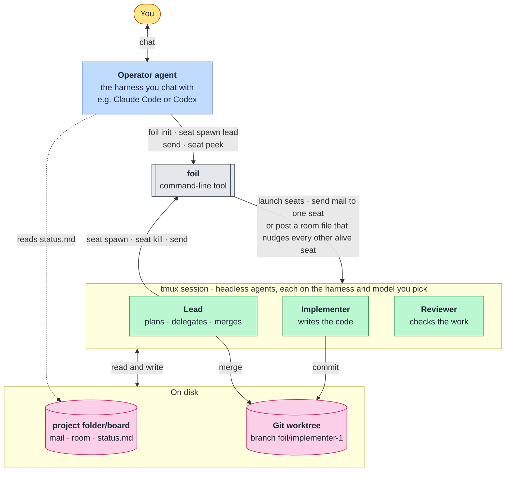

# Foil · 运筹

[](LICENSE)
[](https://github.com/TiantianFlow/foil)
[](https://github.com/TiantianFlow/foil/actions/workflows/ci.yml)
[](pyproject.toml)
[](pyproject.toml)
[](pyproject.toml)

[中文](README.zh-CN.md)

**Your agents' loyal opposition.**

Foil turns the coding agents you already use (Claude Code, Codex, Gemini, OpenCode, Grok) into a small team. You talk to one agent. It hands your goal to a lead. The lead plans the work, gives each task to a worker with its own Git branch, has another agent check the result, and merges it. Every agent runs in tmux, and every message is a file you can read.

## Why Foil

### Stop managing your agents by hand

The pattern that works is a split: one agent plans, another implements, a third reviews. Claude Code even ships an `opusplan` setting that plans with Opus and builds with Sonnet. Across tools, though, the split usually means you do the plumbing: copy the plan into another terminal, relay the result back, remind each agent what was decided.

Foil makes the split a structure. The lead plans, spawns workers by role, and merges their branches. The task file `board/tasks/<id>.md` is the brief, and the mail is the pointer to it. `foil seat spawn --task` writes that mail and does not write the task file. You talk to one operator agent, and the lead does the managing.

### A clean-context check that doesn't take "done" for an answer

An agent that has worked for an hour grades its own work with everything it believed along the way. It skips the step it forgot, trusts the test it wrote, and says "I'm done" when it isn't. Long sessions make it worse: the context fills up, quality drops, and compaction loses details.

In Foil, every seat starts clean and sees only its role and its task. The reviewer never saw the implementer's reasoning, only the result, so it checks the work instead of the story, and the lead asks for that check before it reports the goal done. Small, clean contexts also let the work run longer and stay correct: each seat does one job, and the plan, mail, and status live on disk, not in anyone's memory. That is the loyal opposition, and where Foil gets its name: a foil is the character whose contrast shows what the other one missed.

### Use the best model for each job, from any provider

Models differ. Some reason better, some write code faster, some cost less, and some still have usage left this week. In Foil, each role is a template with an ordered list of harness entries. Each entry is an id and an optional model, and a spawn takes the entry at the count of seat records already stored for that role. The lead can plan on a strong reasoning model, implementers can run on a fast one, and the reviewer can come from a different vendor, which adds a second kind of independence: different training, different blind spots. Each seat uses its own CLI's login, so the work spreads across subscriptions you already pay for. Foil never stores your keys or logins.

## How it works



- **You** talk only to the operator agent.
- **Operator agent**: any harness you like, with its normal interface. It follows the operator skill and never does the project work itself.
- **foil**: this command-line tool. It launches seats in tmux. `foil send` writes one mail file and nudges that recipient. `foil post` writes one room file and nudges every other alive seat. The body is not typed. Both wait 200ms, then send Enter once. It runs no daemon and never interprets what is on a seat's screen.
- **Lead, implementer, reviewer**: agent CLIs running headless in tmux windows, each started with its role's instructions. By default only the implementer gets its own Git worktree and branch.
- **Board**: mail, room threads, notes, and `status.md`, as plain files in the project folder `foil init` prints. That folder is outside the repository. Seats read mail with `foil mail` and other board files, including room threads, with `foil board`.

## Built to stay out of the way

- **Your own agent runs the fleet.** You don't drive a dashboard or wire agents together by hand. You tell the agent you already use what you want, in whatever interface you like it in, as long as it can run shell commands in your repository. Following one skill file, it starts the lead, checks in, and relays questions.
- **Each CLI works as it is.** Foil starts every agent with that CLI's own documented flags and talks to it the way you would: one short line typed into its window, and the message itself in a file. It never reads the screen to guess what an agent is doing, so a CLI update rarely breaks it, and adding a CLI takes a small preset file, not code.
- **Runs wherever tmux runs.** A command-line tool with no daemon and no GUI, on Linux or macOS, on your laptop or over SSH on a remote machine. Close your terminal and the fleet keeps working; reattach with tmux.
- **Nothing hidden.** Mail, tasks, status, and lessons are plain files, and the work lands on ordinary Git branches. You can read, grep, or edit any of it. They survive a dead tmux session or a reboot, and `foil seat resume` brings the seats back.

## Demo

[docs/demo.md](docs/demo.md) walks through a real run: a failing test, a lead, an implementer, and a reviewer, from `foil init` to the merged fix.

## Get started

You need Python 3.11+, Git, tmux 3.2+, and at least one supported agent CLI (Claude Code, Codex, Gemini, OpenCode, or Grok), already logged in on this machine. Foil never handles that login. Trust is per harness per path. A seat worktree lives in the project folder, outside the repository, so it does not inherit the repository's trust. Each seat label needs folder trust once per harness. A seat waiting on one of those prompts looks, from outside, like a seat that is working. The operator answers an approval dialog: a folder-trust prompt, a login prompt, or a prompt that blocks the seat until you or the operator approve it. It reports an update dialog, a first-run dialog, and an opt-in, and leaves those for you. Another CLI can join with a small preset file once `foil init` has created the project folder.

The human's part is one sentence, typed into the coding agent they already use, in the repository:

```text
Install Foil from https://github.com/TiantianFlow/foil, onboard this repository with it, and start a fleet. My goal: <goal>.
```

To update between goals, kill first, then upgrade, then `foil init`. Run `foil seat kill --all` once the goal is done, run the install line again, run `foil init` in each project, then spawn the lead. A project that still has an in-repo `.foil/` from 0.3.x is killed with that old `foil` before the install line runs. A stale seat whose tmux window is already gone also counts. If that old `foil` is no longer on `PATH`, install 0.3.4 beside the current one, which does not replace it: `UV_TOOL_DIR=DIR UV_TOOL_BIN_DIR=DIR/bin uv tool install "git+https://github.com/TiantianFlow/foil.git@v0.3.4"`, then run `DIR/bin/foil seat kill --all`. With pipx: `PIPX_HOME=DIR PIPX_BIN_DIR=DIR/bin pipx install "git+https://github.com/TiantianFlow/foil.git@v0.3.4"`, then run `DIR/bin/foil seat kill --all`. Do not run `foil init` while those seats remain, and do not move that directory aside. The previous goal's `board/status.md`, in the project folder the report prints, already says `state: done`, so note its `updated` line before you spawn and wait for it to change. After `foil seat kill --all`, either case can occur, so check: run `tmux ls`. If it lists any session, a named preset `env` variable comes from that server and is set with `tmux set-environment -g NAME VALUE` before spawn. If it says no server is running, the next spawn starts a server from your shell.

- The agent installs Foil and runs `foil init`. If that command prints `foil: no harness installed`, it wrote nothing. Install one of the CLIs above and run `foil init` again.
- It reads the report, runs `foil roster list`, and asks you to run each harness id once in this repository and accept its folder-trust, update, first-run, and opt-in prompts, or to confirm that is done. It sets each template's harness list and `permission` with `foil roster`, or by editing `templates/lead.toml`, `templates/implementer.toml`, and `templates/reviewer.toml` in the project folder the report printed. `init` writes one entry. `roster update` `harness` and `model` edit that entry. A longer list is edited in the file, and a spawn takes the entry at the count of seats already stored for that role. `auto` on the lead alone does not let the workers run unattended. Limits says what `auto` still does: the seat can stop on an approval prompt.
- It runs the first-run check and sends the goal.
- It never does the project work itself.

An agent that was started without that sentence uses this pointer line instead:

```text
Read <project folder>/skills/operator.md and follow it. My goal: <goal>.
```

A persistent install of the operator skill is optional. Copy it where that harness discovers skills, at user level, so it stays out of `git status`. No path below was checked against that harness's current docs.

| Harness | Install path | Verified |
|---|---|---|
| any | the pointer line above | required; not a per-harness install |
| Claude Code | `~/.claude/skills/foil-operator/SKILL.md` | no |
| grok, codex, opencode, gemini | none published | no |

### By hand

The same steps, typed yourself. Install Foil, then in the repository:

```sh
uv tool install "git+https://github.com/TiantianFlow/foil.git"
cd your-repo
foil init
```

Read the report and set the three templates with `foil roster` or by editing the files. If `board/status.md` is already in the project folder, note its `updated` value. Then spawn the lead once:

```sh
foil seat spawn lead --task "Write board/status.md with state: done"
```

When `board/status.md` in the project folder shows `state: done`, send the goal to that lead. If that file was already there, this passes only after `updated` changes. Do not spawn the lead again. The lead's first prompt already carries its instructions, so a message holds only the goal or an answer.

```sh
foil send lead "the goal"
foil seat list
foil seat peek lead
```

`board/status.md` in the project folder is the lead's own report, including any questions for you; answer them with `foil send lead "..."`. It carries a checklist of what is done and what is left, and the operator reports it at each check-in and whenever the human asks. When you are done, `foil seat kill --all` stops every seat and leaves branches and worktrees in place. A leftover seat worktree is `<project folder>/worktrees/<label>`. Remove one that is clean with `git worktree remove <path>`. A dirty tree needs `--force`, and that discards uncommitted work.

### If nothing happens

Run `foil seat peek lead`, and do the same for a seat that was just spawned or resumed. A seat that makes no progress is usually stopped on a dialog. The operator answers an approval dialog: a folder-trust prompt, a login prompt, or a prompt that blocks the seat until someone approves it. It reports an update dialog, a first-run dialog, and an opt-in, and leaves those for you. Answer those in the window (`tmux ls` lists Foil's session and `tmux attach` opens it). A login the CLI will not finish in the pane is done once by hand, then `foil seat kill lead` and spawn the lead again. If `foil seat list` shows that lead as `dead`, `foil seat kill lead` clears it. Spawn the check again only after it is gone.

## Limits

Foil is cooperative protection for seats that follow instructions. It is not isolation from a hostile process. A seat's identity is the `FOIL_SEAT_ID` environment variable Foil sets when it launches that seat. There is no flag a seat can pass to claim another seat. Anything you can do on this machine, a process running as you can do too.

Templates default to `permission = "auto"`. An omitted permission runs the seat unattended. Setting `permission = "ask"` is how a template opts back into prompts: that seat stops at its first approval prompt. Setting `permission = "auto"` inserts that preset's auto flags. For Claude, those flags are `--permission-mode` and `auto`. Claude Code's auto mode can still ask before some commands, so an `auto` seat may stop on an approval prompt. Peek new seats. That seat is still you.

Foil never interprets what is on a seat's screen. `foil seat peek` prints the raw tmux capture, and `foil seat list` reports `alive`, `dead`, or `killed` from whether the seat's window still exists, not from what is on its screen. Agents say whether they are blocked or done in board files. Foil does not scrape a pane, does not decide that a dialog is present, and does not send the keys.

A nudge is typed even when the window is not at a prompt. `foil send` writes the mail file first, then types one line into the recipient's window: the sender, a space, and the mail file's absolute path. `foil post` writes one room file and types that same line into every other alive seat. Either command waits 200ms, then sends Enter once, so a harness that treats Enter inside a fast burst as an unsent paste submits the line instead of leaving it in the input. The message body is never typed. `foil post --re PATH --decline` writes a room file and types nothing. If the agent is not waiting for input, those keystrokes still go into the window. Foil does not look at the screen to decide, and it does not send Enter again.

## Learn more

- [docs/demo.md](docs/demo.md) — a real run, from `foil init` to the merged fix
- [docs/architecture.md](docs/architecture.md) — components, data flow, and module boundaries
- [skills/operator.md](skills/operator.md), [skills/lead.md](skills/lead.md), and [skills/worker.md](skills/worker.md) — what each role runs
- [CONTRIBUTING.md](CONTRIBUTING.md) — setup and checks
- [CHANGELOG.md](CHANGELOG.md) — release history
