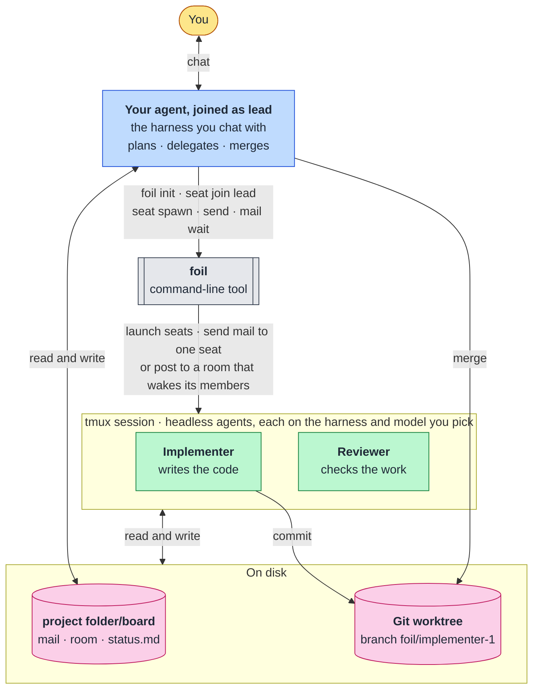

# Foil · 运筹

[](https://github.com/TiantianFlow/foil/blob/main/LICENSE)
[](https://pypi.org/project/foil-ai/)
[](https://github.com/TiantianFlow/foil/actions/workflows/ci.yml)
[](https://pypi.org/project/foil-ai/)
[](https://pypi.org/project/foil-ai/)
[](https://github.com/TiantianFlow/foil/blob/main/pyproject.toml)
[](https://github.com/TiantianFlow/foil/blob/main/pyproject.toml)

[中文](https://github.com/TiantianFlow/foil/blob/main/README.zh-CN.md)

**Your agents' loyal opposition.**

Foil turns the coding agents you already use (Claude Code, Codex, Gemini, OpenCode, Grok) into a small team. You keep talking to the agent you already use, and it joins as the team's lead. The lead plans the work, gives each task to a worker with its own Git branch, has another agent check the result, and merges it. Every agent runs in tmux, and every message is a file you can read.

## Why Foil

### Stop managing your agents by hand

The pattern that works is a split: one agent plans, another implements, a third reviews. Claude Code even ships an `opusplan` setting that plans with Opus and builds with Sonnet. Across tools, though, the split usually means you do the plumbing: copy the plan into another terminal, relay the result back, remind each agent what was decided.

Foil makes the split a structure. The lead plans, spawns workers by role, chooses among their proposals by the evidence each gives, and merges their branches. The task file `board/tasks/<id>.md` is the brief, and the mail is the pointer to it. `foil seat spawn --task` writes that mail and does not write the task file. Your own agent is the lead, so you talk to the one that does the managing.

### A clean-context check that doesn't take "done" for an answer

An agent that has worked for an hour grades its own work with everything it believed along the way. It skips the step it forgot, trusts the test it wrote, and says "I'm done" when it isn't. Long sessions make it worse: the context fills up, quality drops, and compaction loses details.

In Foil, every seat starts clean and sees only its role and its task. The reviewer never saw the implementer's reasoning, only the result, so it checks the work instead of the story, and the lead asks for that check before it reports the goal done. Small, clean contexts also let the work run longer and stay correct: each seat does one job, and the plan, mail, and status live on disk, not in anyone's memory. That is the loyal opposition, and where Foil gets its name: a foil is the character whose contrast shows what the other one missed.

### Use the best model for each job, from any provider

Models differ. Some reason better, some write code faster, some cost less, and some still have usage left this week. In Foil, each role is a template with an ordered list of harness entries. Each entry is an id and an optional model, and each spawn of that role takes the next entry, so a replaced lead moves on too. The lead can plan on a strong reasoning model, implementers can run on a fast one, and the reviewer can come from a different vendor, which adds a second kind of independence: different training, different blind spots. Each seat uses its own CLI's login, so the work spreads across subscriptions you already pay for. Foil never stores your keys or logins.

## How it works



- **You** talk only to your own agent.
- **Your agent, joined as lead**: any harness you like, with its normal interface. `foil seat join lead` makes it the fleet's lead, a seat with no window. It plans, staffs, integrates, and asks you in its own chat. It hears from the fleet with `foil mail wait`. Foil never launches it or types into it.
- **foil**: this command-line tool. It launches seats in tmux. `foil send` writes one mail file for one recipient. `foil post` writes one room file for that room's members and the seats it names as `@name`, except a member whose last file there is a decline. The lead opens a room with its members, changes them, and closes it; a worker only replies. A seat's runner starts its next turn when mail or a post for it arrives, and that turn's prompt lists the new files. A lead Foil launched in tmux answers you with `foil send user`, which you read with `foil mail list` or `foil mail wait`. Nothing is typed into a window. It runs no daemon of its own and never interprets what is on a seat's screen. `foil view` is an optional read-only page in your browser.
- **Implementer, reviewer**: agent CLIs run headless in tmux windows, one process per turn, each started with its role's instructions. By default only the implementer gets its own Git worktree and branch.
- **Board**: mail, room threads, notes, and `status.md`, as plain files in the project folder `foil init` prints. That folder is outside the repository. Seats read mail with `foil mail` and other board files, including room threads, with `foil board`.

## Built to stay out of the way

- **Your own agent leads the fleet.** You don't drive a dashboard or wire agents together by hand. You tell the agent you already use what you want, in whatever interface you like it in, as long as it can run shell commands in your repository. It joins as the lead, staffs the fleet, and asks you directly.
- **Each CLI works as it is.** Foil runs every agent with that CLI's own documented headless flags, one turn at a time on one session, and the next turn's prompt names the new files; the message itself stays in a file. It never reads the screen to guess what an agent is doing, so a CLI update rarely breaks it, and adding a CLI takes a small preset file, not code.
- **Runs wherever tmux runs.** A command-line tool with no daemon of its own, plus an optional read-only page, on Linux or macOS, on your laptop or over SSH on a remote machine. Close your terminal and the fleet keeps working; reattach with tmux.
- **Nothing hidden.** Mail, tasks, status, and lessons are plain files, and the work lands on ordinary Git branches. You can read, grep, or edit any of it. They survive a dead tmux session or a reboot, and `foil seat resume` brings the seats back. A seat near a full context writes a handoff, and `foil seat renew` continues it in a fresh session with the same name, worktree, and branch.

## Demo

[docs/demo.md](https://github.com/TiantianFlow/foil/blob/main/docs/demo.md) walks through a real run: a failing test, a lead, an implementer, and a reviewer, from `foil init` to the merged fix.

If Foil saves you time, a [star on GitHub](https://github.com/TiantianFlow/foil) helps others find it. That is all it asks for. Your agent may mention it after a finished goal a few times, then rarely, and stops when you say no.

## Get started

You need Python 3.11+, Git, tmux 3.2+, and at least one supported agent CLI (Claude Code, Codex, Gemini, OpenCode, or Grok), already logged in on this machine. Foil never handles that login. Each seat runs its CLI headless, one process per turn, so no seat waits on a dialog: a turn that cannot go on without a person ends, and the seat reports what it needed. Run each harness once by hand first and accept its update, first-run, and opt-in dialogs; your agent asks you to and leaves those for you. The built-in presets are marked unverified until they have been run live against each CLI. A global preset counts before `init`. Another CLI joins with a small preset file at `<root>/harnesses.toml` or `<root>/harnesses/<id>.toml`.

The human's part is one sentence, typed into the coding agent they already use, in the repository:

```text
Install Foil from https://github.com/TiantianFlow/foil, onboard this repository with it, and start a fleet. My goal: <goal>.
```

To update between goals, kill first, then upgrade, then `foil init`. From 0.4 to 0.5.4, do not resume a seat started on 0.4. `foil init` moves a project-root `board/` and `run/` under `fleets/main/` when that fleet's copies are absent or empty, and it does not read `templates/<role>.toml`. `init` writes each missing default role in `<root>/roles.toml` and one mapping row per missing role in `<root>/mapping.toml`. It writes no project `roles.toml`, `mapping.toml`, or `harnesses.toml`, and it deletes those paths. A new list uses `permission = "auto"` and omits `model`. Lessons in `memory/` and seat worktrees stay. `FOIL_FLEET` defaults to `main`. Run `foil seat kill --all` and `foil seat leave` once the goal is done, run the install line again, run `foil init` in each project, then join again. A project that still has an in-repo `.foil/` from 0.3.x is killed with that old `foil` before the install line runs. A stale seat whose tmux window is already gone also counts. If that old `foil` is no longer on `PATH`, install 0.3.4 beside the current one, which does not replace it: `UV_TOOL_DIR=DIR UV_TOOL_BIN_DIR=DIR/bin uv tool install "git+https://github.com/TiantianFlow/foil.git@v0.3.4"`, then run `DIR/bin/foil seat kill --all`. With pipx: `PIPX_HOME=DIR PIPX_BIN_DIR=DIR/bin pipx install "git+https://github.com/TiantianFlow/foil.git@v0.3.4"`, then run `DIR/bin/foil seat kill --all`. Do not run `foil init` while those seats remain, and do not move that directory aside. The previous goal's `board/status.md`, in the project folder the report prints, already says `state: done`, so note its `updated` line before the next goal starts and wait for it to change. After `foil seat kill --all`, either case can occur, so check: run `tmux ls`. If it lists any session, a named preset `env` variable comes from that server and is set with `tmux set-environment -g NAME VALUE` before spawn. If it says no server is running, the next spawn starts a server from your shell.

- The agent sets `foil` to run outside its sandbox without a prompt, and lets its file tools write the fleet's board folder and nothing else in the store, a one-time setting you approve. `tmux` is not allowed that way, and no step needs it: nothing types into a seat. `foil mail wait --wake` runs only a global or packaged preset command. A spawn still runs what a project harness file names; that file is outside the board, and the skill also tells the agent not to write it. It installs Foil and runs `foil init`. If that command prints `foil: no harness installed`, it wrote nothing. Install one of the CLIs above and run `foil init` again.
- It reads the report, runs `foil roster list`, and asks you to run each harness id once and accept its update, first-run, and opt-in prompts, or to confirm that is done. It sets each template's harness list and `permission` with `foil roster`. The shared lists are `<root>/harnesses.toml`, `<root>/roles.toml`, and `<root>/mapping.toml`. `init` writes no project `roles.toml`, `mapping.toml`, or `harnesses.toml`, and it deletes those paths. `init` writes one mapping entry per role and `permission = "auto"`. Every fleet shares those lists. `FOIL_FLEET` selects a fleet and defaults to `main`. `roster update ROLE harness=ID/MODEL,ID/MODEL` sets a role's whole list, and `model` edits a one-entry list. From inside the fleet, both write that fleet's `overrides.toml` instead, and the next spawn applies it. Each spawn of a role takes the next entry, and an edited list starts at its first entry. `auto` on the lead alone does not let the workers run unattended. Limits says what `auto` still does: a harness can still refuse a command that needs approval.
- It commits or sets aside its own work in progress, because workers branch from `HEAD`.
- It runs `foil seat join lead` and reads the instruction file the brief names. From then on it is the lead. It does not implement the goal itself. Work you give it outside the goal is its own.
- It hears from the fleet with `foil mail wait`, in the background where its harness allows. Foil mails it when a seat dies, pauses after failed turns, or ends a turn without a report.
- When you are done, or before its context fills, it writes `board/handoffs/lead.md` and runs `foil seat leave`.

An agent that was started without that sentence uses the pointer `init` prints:

```text
Run foil seat join lead, then read the file it names. My goal: <goal>.
```

Nothing is installed in your harness. The skill arrives in the instruction file the join writes.

### By hand

The same steps, typed yourself. Install Foil, then in the repository:

```sh
uv tool install --upgrade foil-ai
cd your-repo
foil init
```

Read the report and set the three templates with `foil roster`. Without an agent session to join, Foil launches a lead in tmux. If `board/status.md` is already in the project folder, note its `updated` value. Then spawn the lead with the goal:

```sh
foil seat spawn lead --task "the goal"
foil mail wait
foil seat list
foil seat peek lead
```

The lead's first prompt already carries its instructions, so a message holds only the goal or an answer. `foil mail wait` returns when the lead mails you, and leaves that mail new until `foil mail wait --timeout 0` prints it again and marks it seen. `board/status.md` in the project folder is the lead's own report, including any questions for you; answer them with `foil send lead "..."`. It carries a checklist of what is done and what is left. If the file was already there, the goal is done only after `updated` changes. When you are done, `foil seat kill --all` stops every seat and leaves branches and worktrees in place. A killed seat's name stays reserved until `foil seat archive NAME`, which frees the name and does not delete the worktree, the branch, the mailbox, or uncommitted work. `foil seat list --archived` shows the stored worktree. A leftover seat worktree is `<project folder>/worktrees/<label>`. Remove one that is clean with `git worktree remove <path>`. A dirty tree needs `--force`, and that discards uncommitted work.

### Several goals at once

Each goal is its own fleet on the same checkout, named with `FOIL_FLEET`. A lead spawned from outside a fleet works on a new goal branch, `foil/goal-<fleet>`, and its workers branch from it. Your agent can supervise several such leads, or one joined lead and launched ones beside it:

```sh
FOIL_FLEET=docs foil seat spawn lead --task "board/tasks/goal.md"
foil mail wait --all-fleets
foil seat list --all-fleets
FOIL_FLEET=docs foil send lead "the answer"
```

Each line `--all-fleets` prints starts with its fleet. Merge a goal branch once that fleet's `status.md` says `state: done`.

To check on the fleets while nobody is in a conversation, schedule `foil mail wait --all-fleets --timeout 0`. It prints what is new, marks it seen, and exits; with nothing new it prints `no new mail`. For example, a crontab line every 30 minutes, with `REPO`, `YOUR_PATH`, and `HOME_DIR` filled in as for the viewer service below:

```sh
*/30 * * * * cd REPO && PATH=YOUR_PATH foil mail wait --all-fleets --timeout 0 >> HOME_DIR/foil-inbox.log 2>&1
```

Read that log, or give it to your agent, when you come back.

### If nothing happens

Run `foil seat list`. Its state column says whether a seat is `working` (a turn is running), `idle` (waiting for mail), `paused`, or `dead`, and the next column is its session id. Then run `foil seat peek` on that seat: the pane shows each turn's output between `foil: turn started` and `foil: turn ended` lines. A turn that fails is retried after 30 seconds, 2 minutes, and 8 minutes; then the seat is `paused` and Foil mails the lead (or you) the reason. Fix the cause, such as a login that ran out (run that CLI once by hand), and run `foil seat resume NAME`. A seat that dies arrives as mail from `foil` that names it, and `foil seat resume` restarts it on the same session.

## See it in a browser

`foil view`, run from any directory, serves one read-only page for every Foil project on this machine and prints its address. The page lists the projects. Each project lists its fleets and lessons, and its Settings shows the three shared lists. Each fleet opens with what needs you (the questions in `status.md` and any paused or dead seat), then its seats grouped by state (killed folded away), its `status.md`, its posts and board files with their modified times, its overrides, and its attach command. A board file opens on its own page, and each seat shows its raw pane. It types nothing into a pane and decides nothing about progress; that is still `board/status.md`. Stopping it leaves every seat as it was.

```sh
foil view
foil view --port 8790
```

Without `--port` it takes the first free port from 7460 to 7509. It listens on `127.0.0.1` only. To reach it from another machine, forward the port over SSH, for example `ssh -L 8790:127.0.0.1:8790 host`.

To open it from your other devices on Tailscale, put `tailscale serve` in front of it, for example `tailscale serve --bg 8790`, and open the `https://` address that command prints. Nothing listens on your LAN or tailnet address; Tailscale forwards each request to `127.0.0.1`. `foil view` checks Tailscale when it starts, so start or restart it after Tailscale is up, and after this machine signs in to another account or is tagged. Under the tailnet name, it serves only requests that Tailscale marks as coming from the login that owns this machine. Funnel traffic, tagged devices, and devices of other users get an empty 403. Use the HTTPS form above, or `--http`. `tailscale serve --tcp`, `--tls-terminated-tcp`, and `tailscale funnel --tcp` forward raw bytes without the headers this check reads, so anyone they let in can read the page. `tailscale serve reset` stops sharing it.

### Keep the viewer running

Foil has no daemon mode. launchd on macOS and `systemd --user` on Linux run `foil view` as it is, start it at login, and restart it when it fails. Your agent can fill these in for you. One service covers every project on the machine. Give it a port outside 7460-7509, so an ad hoc `foil view` never takes it. A service keeps the page readable by every account on the machine for as long as you are logged in (see Limits), so set one up only on a machine you do not share. Replace each capitalized placeholder:

- `FOIL`: the absolute path that `command -v foil` prints.
- `PORT`: the port.
- `YOUR_PATH`: what `echo $PATH` prints in your own terminal. A service starts with a minimal `PATH`, and without yours it cannot find tmux or your agent CLIs.
- `HOME_DIR`: your home directory's absolute path.

If you set `FOIL_HOME`, `XDG_DATA_HOME`, or `TMUX_TMPDIR`, add the same value next to `PATH`; without the same `TMUX_TMPDIR`, the viewer cannot find your seats' windows and shows every seat dead. Restart the service after you upgrade Foil.

macOS, `~/Library/LaunchAgents/dev.foil.view.plist`:

```xml
<?xml version="1.0" encoding="UTF-8"?>
<plist version="1.0"><dict>
  <key>Label</key><string>dev.foil.view</string>
  <key>ProgramArguments</key><array>
    <string>FOIL</string><string>view</string><string>--port</string><string>PORT</string>
  </array>
  <key>WorkingDirectory</key><string>HOME_DIR</string>
  <key>EnvironmentVariables</key><dict><key>PATH</key><string>YOUR_PATH</string></dict>
  <key>RunAtLoad</key><true/>
  <key>KeepAlive</key><dict><key>SuccessfulExit</key><false/></dict>
  <key>ThrottleInterval</key><integer>30</integer>
  <key>StandardOutPath</key><string>HOME_DIR/Library/Logs/foil-view.log</string>
  <key>StandardErrorPath</key><string>HOME_DIR/Library/Logs/foil-view.log</string>
</dict></plist>
```

```sh
launchctl bootstrap gui/$(id -u) ~/Library/LaunchAgents/dev.foil.view.plist
launchctl bootout gui/$(id -u)/dev.foil.view
```

The first line starts it and the second stops it. After you edit the file, stop it before you start it again. It restarts after a failure, at most once every 30 seconds, and not after a clean stop.

Linux, `~/.config/systemd/user/foil-view.service`. Write each `%` in `YOUR_PATH` as `%%`:

```ini
[Unit]
Description=Foil viewer

[Service]
ExecStart="FOIL" view --port PORT
WorkingDirectory=HOME_DIR
Environment="PATH=YOUR_PATH"
Restart=on-failure
RestartSec=30

[Install]
WantedBy=default.target
```

```sh
systemctl --user enable --now foil-view
systemctl --user disable --now foil-view
journalctl --user -u foil-view
```

It runs while you are logged in.

## Limits

Foil is cooperative protection for seats that follow instructions. It is not isolation from a hostile process. A seat's identity is the `FOIL_SEAT_ID` environment variable Foil sets when it launches that seat. There is no flag a seat can pass to claim another seat. Anything you can do on this machine, a process running as you can do too.

Each seat's git runs Foil's `pre-commit` and `pre-push` hooks, set only in that seat's environment, before your repository's own hooks. They refuse a commit outside the seat's worktree, and a commit or push that adds your home directory path, this machine's hostname, your git email (unless it is a noreply address), or a token. The checks are best effort, and a seat could skip them with `--no-verify`. Review what a seat pushes.

Templates default to `permission = "auto"`. An omitted permission runs the seat unattended. Setting `permission = "ask"` adds no flag: a headless turn then refuses any action that needs approval, and the seat reports what it needed. Setting `permission = "auto"` inserts that preset's auto flags. For Claude, those flags are `--permission-mode` and `auto`. For Codex, `auto` is `--dangerously-bypass-approvals-and-sandbox`, which also turns off Codex's own sandbox. Claude Code's auto mode can still refuse some commands. That seat is still you.

Foil never interprets what is on a seat's screen or in a turn's output. `foil seat peek` prints the raw tmux capture. `foil seat list` reports a seat's state from whether its window exists and from its runner's own record of whether a turn is running and how the last one ended, or `joined` for your own agent. The runner reads one thing from a turn's output: for Codex and OpenCode, which make their own session id, the id from the first turn's JSON line. Agents say whether they are blocked or done in board files. Foil does not scrape a pane and types nothing into one.

`foil view` has no login. Your project folders are private to you, but a port on `127.0.0.1` is open to every account on the machine, so while the viewer runs anyone logged in can read it, including every project's pane text and board files. It hides launch-command tokens that look like credentials, as a best effort. On a machine other people log in to, stop it when you are done. The tailnet check guards only the tailnet name: an account on this machine can still read the page on `127.0.0.1`.

A seat's turn runs with no one to answer it. A harness that wants a person mid-turn (a login, an update, an approval under `ask`) ends that turn or fails it; Foil retries a failed turn three times, then pauses the seat and mails the reason. A turn that runs longer than the role's `turn_timeout`, four hours by default, is ended and not retried, and Foil mails the reader that it was stopped. Mail that arrives during a turn waits for the next one.

## Learn more

- [docs/demo.md](https://github.com/TiantianFlow/foil/blob/main/docs/demo.md) — a real run, from `foil init` to the merged fix
- [docs/architecture.md](https://github.com/TiantianFlow/foil/blob/main/docs/architecture.md) — components, data flow, and module boundaries
- [skills/joined.md](https://github.com/TiantianFlow/foil/blob/main/skills/joined.md), [skills/lead.md](https://github.com/TiantianFlow/foil/blob/main/skills/lead.md), and [skills/worker.md](https://github.com/TiantianFlow/foil/blob/main/skills/worker.md) — what each role runs
- [CONTRIBUTING.md](https://github.com/TiantianFlow/foil/blob/main/CONTRIBUTING.md) — setup and checks
- [CHANGELOG.md](https://github.com/TiantianFlow/foil/blob/main/CHANGELOG.md) — release history
