# 运筹 · Foil

[](LICENSE)
[](https://pypi.org/project/foil-ai/)
[](https://github.com/TiantianFlow/foil/actions/workflows/ci.yml)
[](https://pypi.org/project/foil-ai/)
[](https://pypi.org/project/foil-ai/)
[](pyproject.toml)
[](pyproject.toml)

[English](README.md)

**你的 Agent 们的忠诚反对派。**

运筹把你已经在用的编程 Agent（Claude Code、Codex、Gemini、OpenCode、Grok）组成一支小团队。你继续和自己已经在用的 Agent 对话，它加入团队，成为主座。主座规划工作，把每个任务交给有自己 Git 分支的工人席位，让另一个 Agent 检查结果，再把结果合并。每个 Agent 都跑在 tmux 里，每条消息都是你能直接读的文件。

## 为什么选择运筹

### 不必再亲手管理你的 Agent

行之有效的做法是分工：一个 Agent 规划，一个实现，一个审查。Claude Code 甚至自带 `opusplan` 设置，用 Opus 规划、用 Sonnet 动手。但跨工具时，这种分工通常意味着由你来打杂：把计划复制到另一个终端，再把结果转述回来，还要提醒每个 Agent 之前定过什么。

运筹把这种分工变成结构。主座负责规划，按角色派出工人席位，根据各自给出的证据在它们的提案中做出选择，再合并它们的分支。任务文件 `board/tasks/<id>.md` 是任务说明，邮件是指向它的指针。`foil seat spawn --task` 写成那封邮件，并不写任务文件。你自己的 Agent 就是主座，所以你直接和负责管理的那一个对话。

### 一个不轻信"做完了"的干净上下文检查

一个干了一小时的 Agent，会带着一路上相信过的一切来给自己的工作打分。它会跳过自己忘掉的那一步，相信自己写的测试，在没做完的时候说"做完了"。会话越长越糟：上下文越塞越满，质量下降，压缩还会丢掉细节。

在运筹里，每个席位都从干净的上下文开始，只看到自己的角色和任务。审查者从没看过实现者的思路，只看结果，所以它检查的是工作本身，而不是那套说法；主座在报告目标完成之前，会先请审查者检查。小而干净的上下文还让工作能持续更久、保持正确：每个席位只做一件事，计划、邮件和状态都在磁盘上，而不是在谁的记忆里。这就是"忠诚反对派"，也是 Foil 这个名字的由来：foil 指的是那个用反差照出另一个角色疏漏的角色。

### 每项工作都用最合适的模型，不限厂商

模型各有长短：有的更会推理，有的写代码更快，有的更便宜，有的这周还剩额度。在运筹里，每个角色是一个模板，里面是一份有序的 harness 列表，每一项是一个 id 和可选的模型。该角色每启动一次就取下一项，所以换掉的主座也会轮到下一项。主座可以用擅长推理的模型做规划，实现者可以用快速的模型，审查者可以来自另一家厂商，这又多了一层独立性：训练不同，盲区也不同。每个席位各自使用自己 CLI 的登录，工作因此分摊到你已经付费的多个订阅上。运筹从不保存你的密钥或登录信息。

## 它如何运转

```mermaid
flowchart TB
  you(["你"])
  lead["<b>你的 Agent，作为主座加入</b><br/>你与之对话的 harness<br/>规划 · 分派 · 合并"]
  foil[["<b>foil</b><br/>命令行工具"]]

  subgraph fleet["tmux 会话 · 无界面的 Agent，各自用你选的 harness 和模型"]
    impl["<b>实现者</b><br/>写代码"]
    rev["<b>审查者</b><br/>检查工作"]
  end

  subgraph disk["磁盘上"]
    board[("<b>项目目录/board</b><br/>邮件 · 房间 · status.md")]
    tree[("<b>Git worktree</b><br/>分支 foil/implementer-1")]
  end

  you <-->|对话| lead
  lead -->|"foil init · seat join lead<br/>seat spawn · send · mail wait"| foil
  foil -->|"启动席位 · 给一个席位发邮件<br/>或写房间文件，唤醒房间成员"| fleet
  fleet <-->|读写| disk
  lead <-->|读写| board
  impl -->|提交| tree
  lead -->|合并| tree

  classDef human fill:#fde68a,stroke:#b45309,color:#1f2937
  classDef yours fill:#bfdbfe,stroke:#1d4ed8,color:#1f2937
  classDef tool fill:#e5e7eb,stroke:#374151,color:#1f2937
  classDef seat fill:#bbf7d0,stroke:#15803d,color:#1f2937
  classDef data fill:#fbcfe8,stroke:#be185d,color:#1f2937
  class you human
  class lead yours
  class foil tool
  class impl,rev seat
  class board,tree data
```



- **你**只和自己的 Agent 对话。
- **你的 Agent，作为主座加入**：你喜欢的任何 harness，带着它原本的界面。`foil seat join lead` 让它成为舰队的主座，一个没有窗口的席位。它规划、派人、整合，有问题就在自己的对话里问你。它用 `foil mail wait` 接收舰队的消息。运筹从不启动它，也从不往它里面打字。
- **foil**：就是这个命令行工具。它在 tmux 里启动席位。`foil send` 为一个收件人写成一份邮件文件。`foil post` 为该房间的成员，以及用 `@名字` 点到的席位写成一份房间文件；最后一份文件是 decline 的成员不会被唤醒。主座开房间、指定和调整成员、关闭房间；工作席位只回复。有新邮件或新帖子到达时，席位的运行器开始它的下一轮，这一轮的提示列出新文件。运筹在 tmux 里启动的主座用 `foil send user` 回复你，你用 `foil mail list` 或 `foil mail wait` 读取。运筹不往任何窗口里打字。`foil master start` 在这台机器上启动一个 master，位于所有舰队之上。你和主座用 `foil send master` 给它发信。它只提议，不合并、不停止席位、不归档。它自己不跑守护进程，也从不解读席位屏幕上显示的内容。桥是浏览器里的页面。
- **实现者、审查者**：在 tmux 窗口里无界面运行的 Agent CLI，每一轮一个进程，每个都带着自己角色的指令启动。默认只有实现者拥有自己的 Git worktree 和分支。
- **看板**：邮件、房间线程、笔记和 `status.md`，都是普通文件，放在 `foil init` 报告打印的项目目录里。这个目录在仓库之外。席位用 `foil mail` 读邮件，用 `foil board` 读板上的其他文件，包括房间线程。

## 尽量不碍事的设计

- **由你自己的 Agent 来带领舰队。** 你不需要操作仪表盘，也不用亲手把 Agent 连在一起。你只要告诉自己常用的那个 Agent 想做什么，用哪个界面都行，只要它能在你的仓库里执行命令。它作为主座加入，安排人手，有问题直接问你。
- **每个 CLI 都按原样使用。** 运筹用每个 CLI 自己公开的无界面参数运行它，在同一个会话上一次一轮，下一轮的提示列出新文件的路径；消息本身留在文件里。它从不读屏幕去猜 Agent 在做什么，所以 CLI 升级很少会让它失效；接入新的 CLI 只需要一个小小的预设文件，不用写代码。
- **有 tmux 的地方就能跑。** 一个命令行工具，自己没有守护进程，另有一个可选的只读网页，可以在 Linux 或 macOS 上运行，本机或通过 SSH 连到远程机器都行。关掉终端，舰队照样工作；用 tmux 重新连上即可。
- **没有暗箱。** 邮件、任务、状态和经验都是普通文件，工作成果落在普通的 Git 分支上。你可以直接阅读、搜索或修改其中任何一项。它们经得住 tmux 会话被杀或机器重启，`foil seat resume` 会把席位重新拉起来。上下文快满的席位写一份交接，`foil seat renew` 用新会话接着做，名字、工作树和分支都不变。

## 演示

[docs/demo.zh-CN.md](docs/demo.zh-CN.md) 完整走一遍真实运行：一个失败的测试、一个主座、一个实现者和一个审查者，从 `foil init` 一直到修复被合并。

如果运筹帮你省了时间，在 GitHub 上[点一个 Star](https://github.com/TiantianFlow/foil) 能帮更多人找到它。我们只请求这一点。完成目标后，你的智能体可能会提几次，之后很少再提；你说不用，它就不再提。

## 开始使用

你需要 Python 3.11+、Git、tmux 3.2+，以及至少一个已在本机登录、受支持的 Agent CLI（Claude Code、Codex、Gemini、OpenCode 或 Grok）。运筹从不经手这次登录。每个席位都无界面地运行它的 CLI，每一轮一个进程，所以没有席位会停在对话框上：需要人才能继续的一轮会结束，席位报告它需要什么。先手动把每个 harness 运行一次，接受它的更新、首次运行和意见征集对话框；你的 Agent 会请你这样做，并把这些留给你。内置预设在对每个 CLI 实际跑过之前，都标为未验证。全局预设在 `init` 之前就算数。其他 CLI 用 `<root>/harnesses.toml` 或 `<root>/harnesses/<id>.toml` 里的一个小预设文件接入。

人要做的只有一句话。在仓库里，把它交给你已经在用的编程 Agent：

```text
Install Foil from https://github.com/TiantianFlow/foil, onboard this repository with it, and start a fleet. My goal: <goal>.
```

要从 0.4 升到 0.5.4，在两个目标之间做，不要恢复 0.4 启动的席位。`foil init` 会在 `fleets/main/` 里还没有对应目录、或目录是空的时候，把项目根上的 `board/` 和 `run/` 移进去。它不读取 `templates/<role>.toml`。`init` 把每个还没有的默认角色写进 `<root>/roles.toml`，并在 `<root>/mapping.toml` 里为每个还没有的角色写一行映射。它不写项目里的 `roles.toml`、`mapping.toml` 或 `harnesses.toml`，并且删掉这些路径。新写的清单是 `permission = "auto"`，并且不写 `model`。`memory/` 里的教训和席位工作树都留着。`FOIL_FLEET` 默认是 `main`。要在两个目标之间更新，顺序是先停掉、再升级、最后 `foil init`：目标完成后运行 `foil seat kill --all` 和 `foil seat leave`，再运行一次安装命令，然后在每个项目里运行 `foil init`，再重新加入。还留着 0.3.x 仓库内 `.foil/` 的项目，要在运行安装命令之前用那个旧的 `foil` 停掉。tmux 窗口已经不在的过期席位同样算在内。如果 `PATH` 上已经没有那个旧的 `foil`，就在旁边安装 0.3.4，这不会替换当前的 `foil`：`UV_TOOL_DIR=DIR UV_TOOL_BIN_DIR=DIR/bin uv tool install "git+https://github.com/TiantianFlow/foil.git@v0.3.4"`，然后运行 `DIR/bin/foil seat kill --all`。用 pipx 则是：`PIPX_HOME=DIR PIPX_BIN_DIR=DIR/bin pipx install "git+https://github.com/TiantianFlow/foil.git@v0.3.4"`，然后运行 `DIR/bin/foil seat kill --all`。那些席位还在时不要运行 `foil init`，也不要把那个目录挪走。上一个目标留在报告打印的项目目录里的 `board/status.md` 已经写着 `state: done`，所以下一个目标开始前先记下它的 `updated` 行，等它变化。`foil seat kill --all` 之后两种情况都可能出现，所以要检查：运行 `tmux ls`。如果列出了任何会话，预设里点名的 `env` 变量来自该服务器，启动前用 `tmux set-environment -g NAME VALUE` 设置。如果它说没有服务器在运行，下一次启动会从你的 shell 拉起服务器。

- Agent 把 `foil` 设为在沙箱外、不经提示运行，并让自己的文件工具只能写这个舰队的看板目录，存储里的其他目录都不行（这是一次性设置，由你批准）。`tmux` 不这样放行，也没有哪一步需要它：没有什么会往席位里打字。`foil mail wait --wake` 只运行全局或内置预设里的命令。启动席位时仍会运行项目目录里 harness 文件指定的命令；那个文件在看板目录之外，技能文件也要求 Agent 不要写它。然后安装运筹并运行 `foil init`。如果命令打印 `foil: no harness installed`，它什么都没写。先安装上面的某个 CLI，再运行一次 `foil init`。
- 它读报告，运行 `foil roster list`，并请你把每个 harness id 运行一次，接受它的更新、首次运行和意见征集对话框，或者请你确认已经完成。它用 `foil roster` 设置每个模板的 harness 列表和 `permission`。共用清单是 `<root>/harnesses.toml`、`<root>/roles.toml` 和 `<root>/mapping.toml`。`init` 不写项目里的 `roles.toml`、`mapping.toml` 或 `harnesses.toml`，并且删掉这些路径。`init` 为每个角色写入一条映射，并且 `permission = "auto"`。每个舰队共用这三份清单。`FOIL_FLEET` 选择舰队，默认是 `main`。`roster update ROLE harness=ID/MODEL,ID/MODEL` 一次设置角色的整个列表，`model` 只改只有一项的列表。在舰队里，两者都改写该舰队的 `overrides.toml`，下一次启动会带上它。角色每启动一次就取下一项，列表改过之后从第一项重新开始。只把主座改成 `auto` 不会让工人席位无人值守。限制一节说明 `auto` 下 harness 仍可能拒绝需要审批的命令。
- 它先提交或收起自己手上未完成的改动，因为工人席位从 `HEAD` 开分支。
- 它运行 `foil seat join lead`，读简报里点名的指令文件。从这时起它就是主座。它自己不实现目标。你在目标之外交给它的工作，归它自己。
- 它用 `foil mail wait` 接收舰队的消息，harness 允许时放在后台运行。席位死掉、多轮失败后暂停，或者一轮结束却没有报告时，运筹会给它发邮件。
- 你结束时，或它的上下文快满时，它写好 `board/handoffs/lead.md`，再运行 `foil seat leave`。

没有拿到那句话就启动的 Agent，改用 `init` 打印的指针：

```text
Run foil seat join lead, then read the file it names. My goal: <goal>.
```

你的 harness 里不用安装任何东西。技能随加入时写出的指令文件一起到达。

### 手动操作

同样的步骤，自己来敲。先安装运筹，再在仓库里：

```sh
uv tool install --upgrade foil-ai
cd your-repo
foil init
```

读报告，用 `foil roster` 设置那三个模板。没有可以加入的 Agent 会话时，运筹在 tmux 里启动一个主座。如果项目目录里已经有 `board/status.md`，先记下它的 `updated`。然后带着目标启动主座：

```sh
foil seat spawn lead --task "the goal"
foil mail wait
foil seat list
foil seat peek lead
```

主座的第一条提示已经带上了它的指令，所以消息里只放目标或回答。主座给你发邮件时，`foil mail wait` 就会返回，但那封邮件仍算新的，直到 `foil mail wait --timeout 0` 再打印一次并把它记为已看。项目目录里的 `board/status.md` 是主座自己的报告，也会列出要问你的问题；用 `foil send lead "..."` 回答。`foil inbox` 按固定顺序列出需要你处理的事，`foil brief` 打印每个舰队的目标、状态、最近的日志、未答问题和卡住的项。两者只读文件，不调用模型。它带有一份清单，写明已经完成的和还剩下的。如果这个文件本来就在，只有 `updated` 变了，目标才算完成。结束时，`foil seat kill --all` 会停掉每个席位，分支和 worktree 都会保留。被停掉的席位名字会一直保留，直到 `foil seat archive NAME`。这条命令释放名字，不删除 worktree、分支、邮箱或未提交的工作。`foil seat list --archived` 显示保存的 worktree 路径。留下的席位工作树在 `<项目目录>/worktrees/<label>`。干净的用 `git worktree remove <path>` 删掉。不干净的需要 `--force`，那会丢掉未提交的工作。

### 同时进行几个目标

每个目标是同一个检出目录上的一个舰队，用 `FOIL_FLEET` 命名。从舰队外启动的主座在一个新的目标分支 `foil/goal-<fleet>` 上工作，它的工人从这个分支开分支。你的 Agent 可以同时看管几个这样的主座，或者一个加入的主座加上旁边几个启动的主座：

```sh
FOIL_FLEET=docs foil seat spawn lead --task "board/tasks/goal.md"
foil mail wait --all-fleets
foil seat list --all-fleets
FOIL_FLEET=docs foil send lead "the answer"
```

`--all-fleets` 打印的每一行都以它的舰队开头。那个舰队的 `status.md` 写着 `state: done` 时，用 `foil fleet merge` 合并目标分支。工作区不干净或发生冲突时，命令只拒绝一行，检出保持原样。

没人在对话里时，要查看各个舰队，可以定时运行 `foil mail wait --all-fleets --timeout 0`。它打印新到的内容、标为已读，然后退出；没有新内容时打印 `no new mail`。例如每 30 分钟一次的 crontab 行，`REPO` 是检出目录，`YOUR_PATH` 是你的 `PATH`，`HOME_DIR` 是你的主目录：

```sh
*/30 * * * * cd REPO && PATH=YOUR_PATH foil mail wait --all-fleets --timeout 0 >> HOME_DIR/foil-inbox.log 2>&1
```

回来时读那个日志，或者交给你的 Agent。

### 如果什么都没发生

运行 `foil seat list`。状态一列说明席位是 `working`（一轮正在运行）、`idle`（在等邮件）、`paused` 还是 `dead`，下一列是它的会话 id。然后对那个席位运行 `foil seat peek`：窗格里，每一轮的输出夹在 `foil: turn started` 和 `foil: turn ended` 两行之间。失败的一轮会在 30 秒、2 分钟和 8 分钟后重试；之后席位变成 `paused`，运筹把原因发邮件给主座（或你）。修好原因，比如过期的登录（手动运行一次那个 CLI），再运行 `foil seat resume NAME`。死掉的席位会变成一封来自 `foil`、写明席位名字的邮件，`foil seat resume` 在同一个会话上重启它。

## 在浏览器里查看

页面是桥。`foil bridge install` 写入开机文件，并打印这台机器上的地址。席位页是和那个席位的对话：邮件来自你，每条消息显示它的送达状态。席位若在运筹拥有的 worktree 里，页面可以在对话旁边打开你的 shell；它随视图关闭，不会连上席位。复制附加命令仍会复制 tmux 命令。给工作席位发信时，主座在下一轮醒来时看到一条指针，这条指针不叫醒任何人。已加入的主座要等它的会话在等待时才收到。一个问题可以在那个会话里回答，也可以在页面上回答；先写下的那条是两边都显示的回答。

## 桥

`foil bridge install` 为本机的页面写入开机文件。从首页打开一个席位，就可以给它发信。页面只监听 `127.0.0.1`。没有令牌的请求得到空的 401。首页是和主座的对话，读的是它的邮件，所以 `foil master renew` 之后这些话还在。一个问题是一张卡片：点一个选项，或用文字回复，那条回复会以你的身份寄给主领。主座提出的初始化、设置、新舰队、合并、生成席位、恢复席位或更新席位，只有你点了才执行。一张设置卡片写明改前和改后。设置页上的行与 `foil roster list` 相同，点 Apply 才写入新的驾具顺序。修订已经变了的写入会被拒绝，页面显示前后的差异。它请求的杀死或归档也是一张卡片，确认之前不会执行。舰队页可以暂停或恢复该舰队，按角色生成席位（并显示下一次生成所用的驾具和模型），或把一个新目标开成新舰队。席位页可以恢复、更新、杀死或归档该席位。它也可以在运筹拥有的 worktree 里、在对话旁边打开你的 shell。这个 shell 随视图关闭，不会连上席位。复制附加命令仍会复制 tmux 命令。杀死、归档，以及该舰队授权没有写明的操作，都会先请你确认。主座自己暂停舰队、恢复舰队，并在交接写好后更新主领。页面也给出一个一次性的配对码。通知默认关闭，打开某一类之后才会发送。一条通知只是一个标签，例如 `login: 1 decision`，点开后到那张卡片，不含舰队里的正文。从另一台设备访问时，对该端口运行 `tailscale serve`，然后打开它打印的 https 地址。`PATH` 上没有 `foil-bridge` 时，`foil bridge` 打印安装方式，并不启动页面。`foil doctor` 为每一项检查打印一行。`foil-bridge mcp` 走标准输入输出，`POST /mcp` 走这个进程。`talk_to_master` 以你的身份写信给主座并返回主座的回复，页面上是同一段对话。这条 HTTP 需要令牌。它不能杀死、归档、合并或更改设置。

## 限制

运筹保护的是遵守说明的席位，不是把恶意进程隔离开。席位身份来自运筹启动它时设置的环境变量 `FOIL_SEAT_ID`。没有哪个参数能让一个席位自称是另一个席位。在这台机器上你能做的事，以你的身份运行的进程也能做。

每个席位的 git 会先运行运筹的 `pre-commit` 和 `pre-push` 钩子，再运行你仓库自己的钩子；这些钩子只设在该席位的环境里。它们拒绝席位在自己工作树之外提交，也拒绝新增你的主目录路径、这台机器的主机名、你的 git 邮箱（noreply 地址除外）或令牌的提交和推送。检查只是尽力而为，席位也可以用 `--no-verify` 跳过。请检查席位推送的内容。

模板默认是 `permission = "auto"`。省略 `permission` 时，席位无人值守地运行。把 `permission` 设成 `"ask"` 不加任何参数：无界面的一轮会拒绝任何需要审批的操作，席位报告它需要什么。把 `permission` 设成 `auto` 会插入该预设的自动批准参数。对 Claude，这些参数是 `--permission-mode` 和 `auto`。对 Codex，`auto` 是 `--dangerously-bypass-approvals-and-sandbox`，它同时关掉 Codex 自己的沙箱。Claude Code 的 auto 模式仍可能拒绝某些命令。那个席位仍然是你。

运筹从不解读席位屏幕上的内容，也不解读一轮的输出。`foil seat peek` 打印 tmux 原样捕获的文本。`foil seat list` 报告席位的状态，依据是它的窗口还在不在，以及它的运行器自己记录的：一轮是否正在运行、上一轮怎样结束（你自己的 Agent 则是 `joined`）。运行器只从一轮的输出里读一样东西：对自己生成会话 id 的 Codex 和 OpenCode，读第一轮 JSON 行里的 id。Agent 是否卡住、是否做完，由它们自己写在看板文件里。运筹不抓取窗格，也不往窗格里打字。

桥只监听 `127.0.0.1`，没有令牌时回答 401。tailnet 检查是附加条件，不能代替令牌。它对通过 `tailscale serve` 到达的、属于用户的节点成立，包括已经分享出去的节点，因为访客的登录名不是节点自己的。对带标签的节点和 Funnel 不成立，这些请求会被拒绝。令牌仍然需要。`foil bridge install` 打印的本机地址就是这台机器的令牌；配对过的手机各自保存自己的。

席位的每一轮都没有人来回答它。harness 若在一轮中途需要人（登录、更新、`ask` 下的审批），那一轮就结束或失败；运筹对失败的一轮重试三次，然后暂停席位并发邮件说明原因。运行超过角色 `turn_timeout`（默认四小时）的一轮会被结束，运筹发邮件告诉读者它被停掉了。会话还不存在时，运筹按失败的一轮处理：在 30 秒、2 分钟和 8 分钟后重试，然后暂停席位。会话已经存在时，这一轮的事项记为已送达，席位继续等下一封邮件。一轮进行中到达的邮件，等下一轮再交给它。

## 进一步了解

- [docs/demo.zh-CN.md](docs/demo.zh-CN.md) — 一次真实运行，从 `foil init` 到修复被合并
- [docs/architecture.md](docs/architecture.md) — 组件、数据流和模块边界
- [skills/joined.md](skills/joined.md)、[skills/lead.md](skills/lead.md)、[skills/worker.md](skills/worker.md) — 每个角色运行哪些命令
- [CONTRIBUTING.md](CONTRIBUTING.md) — 搭建与检查
- [CHANGELOG.md](CHANGELOG.md) — 版本历史
