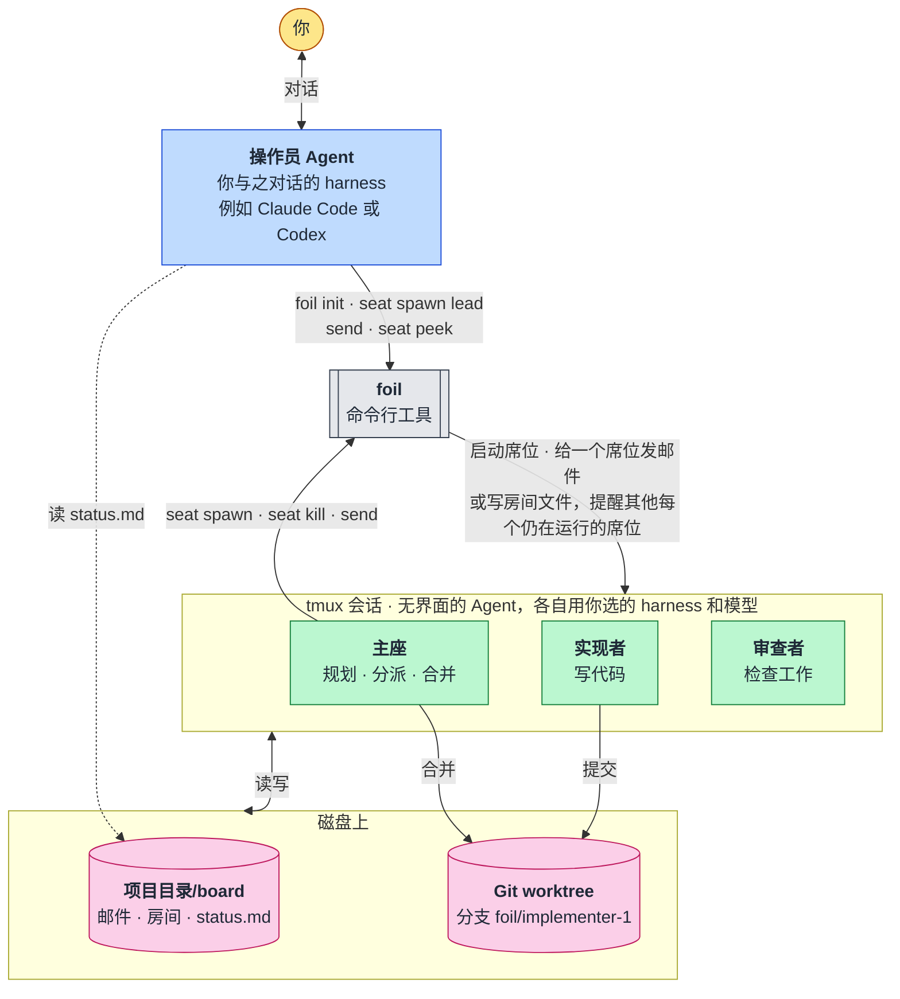

# 运筹 · Foil

[](LICENSE)
[](https://github.com/TiantianFlow/foil)
[](https://github.com/TiantianFlow/foil/actions/workflows/ci.yml)
[](pyproject.toml)
[](pyproject.toml)
[](pyproject.toml)

[English](README.md)

**你的 Agent 们的忠诚反对派。**

运筹把你已经在用的编程 Agent（Claude Code、Codex、Gemini、OpenCode、Grok）组成一支小团队。你只和一个 Agent 对话，它把目标交给主座。主座规划工作，把每个任务交给有自己 Git 分支的工人席位，让另一个 Agent 检查结果，再把结果合并。每个 Agent 都跑在 tmux 里，每条消息都是你能直接读的文件。

## 为什么选择运筹

### 不必再亲手管理你的 Agent

行之有效的做法是分工：一个 Agent 规划，一个实现，一个审查。Claude Code 甚至自带 `opusplan` 设置，用 Opus 规划、用 Sonnet 动手。但跨工具时，这种分工通常意味着由你来打杂：把计划复制到另一个终端，再把结果转述回来，还要提醒每个 Agent 之前定过什么。

运筹把这种分工变成结构。主座负责规划，按角色派出工人席位，再合并它们的分支。任务文件 `board/tasks/<id>.md` 是任务说明，邮件是指向它的指针。`foil seat spawn --task` 写成那封邮件，并不写任务文件。你只和一个操作员 Agent 对话，管理的活由主座来做。

### 一个不轻信"做完了"的干净上下文检查

一个干了一小时的 Agent，会带着一路上相信过的一切来给自己的工作打分。它会跳过自己忘掉的那一步，相信自己写的测试，在没做完的时候说"做完了"。会话越长越糟：上下文越塞越满，质量下降，压缩还会丢掉细节。

在运筹里，每个席位都从干净的上下文开始，只看到自己的角色和任务。审查者从没看过实现者的思路，只看结果，所以它检查的是工作本身，而不是那套说法；主座在报告目标完成之前，会先请审查者检查。小而干净的上下文还让工作能持续更久、保持正确：每个席位只做一件事，计划、邮件和状态都在磁盘上，而不是在谁的记忆里。这就是"忠诚反对派"，也是 Foil 这个名字的由来：foil 指的是那个用反差照出另一个角色疏漏的角色。

### 每项工作都用最合适的模型，不限厂商

模型各有长短：有的更会推理，有的写代码更快，有的更便宜，有的这周还剩额度。在运筹里，每个角色是一个模板，里面是一份有序的 harness 列表，每一项是一个 id 和可选的模型。一次启动取的是该角色已经存下的席位记录条数所对应的那一项。主座可以用擅长推理的模型做规划，实现者可以用快速的模型，审查者可以来自另一家厂商，这又多了一层独立性：训练不同，盲区也不同。每个席位各自使用自己 CLI 的登录，工作因此分摊到你已经付费的多个订阅上。运筹从不保存你的密钥或登录信息。

## 它如何运转



- **你**只和操作员 Agent 对话。
- **操作员 Agent**：你喜欢的任何 harness，带着它原本的界面。它按操作员技能行事，自己从不做项目本身的工作。
- **foil**：就是这个命令行工具。它在 tmux 里启动席位。`foil send` 写成一份邮件文件，并提醒那个收件人。`foil post` 写成一份房间文件，并提醒其他每个仍在运行的席位。正文不会被打进窗口。两者都等待 200ms，然后发送一次 Enter。它不跑守护进程，也从不解读席位屏幕上显示的内容。
- **主座、实现者、审查者**：在 tmux 窗口里无界面运行的 Agent CLI，每个都带着自己角色的指令启动。默认只有实现者拥有自己的 Git worktree 和分支。
- **看板**：邮件、房间线程、笔记和 `status.md`，都是普通文件，放在 `foil init` 报告打印的项目目录里。这个目录在仓库之外。席位用 `foil mail` 读邮件，用 `foil board` 读板上的其他文件，包括房间线程。

## 尽量不碍事的设计

- **由你自己的 Agent 来管理舰队。** 你不需要操作仪表盘，也不用亲手把 Agent 连在一起。你只要告诉自己常用的那个 Agent 想做什么，用哪个界面都行，只要它能在你的仓库里执行命令。它按一份技能文件行事：启动主座、查看进展、转达问题。
- **每个 CLI 都按原样使用。** 运筹用每个 CLI 自己公开的命令行参数启动它，并用你会用的方式和它交流：往它的窗口里打一行短短的提醒，消息本身放在文件里。它从不读屏幕去猜 Agent 在做什么，所以 CLI 升级很少会让它失效；接入新的 CLI 只需要一个小小的预设文件，不用写代码。
- **有 tmux 的地方就能跑。** 一个命令行工具，没有守护进程，也没有图形界面，可以在 Linux 或 macOS 上运行，本机或通过 SSH 连到远程机器都行。关掉终端，舰队照样工作；用 tmux 重新连上即可。
- **没有暗箱。** 邮件、任务、状态和经验都是普通文件，工作成果落在普通的 Git 分支上。你可以直接阅读、搜索或修改其中任何一项。它们经得住 tmux 会话被杀或机器重启，`foil seat resume` 会把席位重新拉起来。

## 演示

[docs/demo.zh-CN.md](docs/demo.zh-CN.md) 完整走一遍真实运行：一个失败的测试、一个主座、一个实现者和一个审查者，从 `foil init` 一直到修复被合并。

如果运筹帮你省了时间，在 GitHub 上[点一个 Star](https://github.com/TiantianFlow/foil) 能帮更多人找到它。我们只请求这一点。`foil init` 会提几次，之后很少再提；在 Foil 存储目录的 `star.json` 里设置 `"stop": true` 后就不再提起，那一行会写出文件路径。

## 开始使用

你需要 Python 3.11+、Git、tmux 3.2+，以及至少一个已在本机登录、受支持的 Agent CLI（Claude Code、Codex、Gemini、OpenCode 或 Grok）。运筹从不经手这次登录。信任按每个 harness、每条路径生效。席位的工作树在项目目录里、仓库之外，所以不会沿用仓库的信任。每个席位标签对每个 harness 都要信任一次。停在这些提示上的席位，从外面看就像一个正在工作的席位。操作员回答的是审批对话框：文件夹信任提示、登录提示，或一个停住席位、直到你或操作员批准的提示。更新对话框、首次运行对话框和意见征集由它报告给你，留给你来回答。其他 CLI 要等 `foil init` 建好项目目录之后，用一个小小的预设文件接入。

人要做的只有一句话。在仓库里，把它交给你已经在用的编程 Agent：

```text
Install Foil from https://github.com/TiantianFlow/foil, onboard this repository with it, and start a fleet. My goal: <goal>.
```

要在两个目标之间更新，顺序是先停掉、再升级、最后 `foil init`：目标完成后运行 `foil seat kill --all`，再运行一次安装命令，然后在每个项目里运行 `foil init`，再启动主座。还留着 0.3.x 仓库内 `.foil/` 的项目，要在运行安装命令之前用那个旧的 `foil` 停掉。tmux 窗口已经不在的过期席位同样算在内。如果 `PATH` 上已经没有那个旧的 `foil`，就在旁边安装 0.3.4，这不会替换当前的 `foil`：`UV_TOOL_DIR=DIR UV_TOOL_BIN_DIR=DIR/bin uv tool install "git+https://github.com/TiantianFlow/foil.git@v0.3.4"`，然后运行 `DIR/bin/foil seat kill --all`。用 pipx 则是：`PIPX_HOME=DIR PIPX_BIN_DIR=DIR/bin pipx install "git+https://github.com/TiantianFlow/foil.git@v0.3.4"`，然后运行 `DIR/bin/foil seat kill --all`。那些席位还在时不要运行 `foil init`，也不要把那个目录挪走。上一个目标留在报告打印的项目目录里的 `board/status.md` 已经写着 `state: done`，所以启动前先记下它的 `updated` 行，等它变化。`foil seat kill --all` 之后两种情况都可能出现，所以要检查：运行 `tmux ls`。如果列出了任何会话，预设里点名的 `env` 变量来自该服务器，启动前用 `tmux set-environment -g NAME VALUE` 设置。如果它说没有服务器在运行，下一次启动会从你的 shell 拉起服务器。

- Agent 安装运筹并运行 `foil init`。如果命令打印 `foil: no harness installed`，它什么都没写。先安装上面的某个 CLI，再运行一次 `foil init`。
- 它读报告，运行 `foil roster list`，并请你在本仓库里把每个 harness id 运行一次，接受它的文件夹信任、更新、首次运行和意见征集对话框，或者请你确认已经完成。它用 `foil roster` 设置每个模板的 harness 列表和 `permission`，也可以直接改报告打印的项目目录里的 `templates/lead.toml`、`templates/implementer.toml` 和 `templates/reviewer.toml`。`init` 写入一项。`roster update` 的 `harness` 和 `model` 改的是这一项。更长的列表要改文件，一次启动取的是该角色已经存下的席位记录条数所对应的那一项。只把主座改成 `auto` 不会让工人席位无人值守。限制一节说明 `auto` 仍可能让席位停在审批提示上。
- 它做首次运行检查，然后把目标发出去。
- 它自己从不做项目本身的工作。

没有拿到那句话就启动的 Agent，改用这行指针：

```text
Read <project folder>/skills/operator.md and follow it. My goal: <goal>.
```

持久安装操作员技能是可选的。把它复制到该 harness 发现技能的位置，放在用户级，这样它不会出现在 `git status` 里。下面的路径都没有对照该 harness 的当前文档核对过。

| Harness | 安装路径 | 已核对 |
|---|---|---|
| 任意 | 上面的指针行 | 必需；不是按 harness 安装 |
| Claude Code | `~/.claude/skills/foil-operator/SKILL.md` | 否 |
| grok、codex、opencode、gemini | 没有公布的路径 | 否 |

### 手动操作

同样的步骤，自己来敲。先安装运筹，再在仓库里：

```sh
uv tool install "git+https://github.com/TiantianFlow/foil.git"
cd your-repo
foil init
```

读报告，用 `foil roster` 或直接改文件来设置那三个模板。如果项目目录里已经有 `board/status.md`，先记下它的 `updated`。然后只启动一次主座：

```sh
foil seat spawn lead --task "Write board/status.md with state: done"
```

当项目目录里的 `board/status.md` 出现 `state: done`，把目标发给这个主座。如果这个文件本来就在，只有 `updated` 变了才算通过。不要再启动一次主座。主座的第一条提示已经带上了它的指令，所以消息里只放目标或回答。

```sh
foil send lead "the goal"
foil seat list
foil seat peek lead
```

项目目录里的 `board/status.md` 是主座自己的报告，也会列出要问你的问题；用 `foil send lead "..."` 回答。它带有一份清单，写明已经完成的和还剩下的，操作员在每次查看时、以及你问起时，报告这份清单。结束时，`foil seat kill --all` 会停掉每个席位，分支和 worktree 都会保留。留下的席位工作树在 `<项目目录>/worktrees/<label>`。干净的用 `git worktree remove <path>` 删掉。不干净的需要 `--force`，那会丢掉未提交的工作。

### 如果什么都没发生

运行 `foil seat peek lead`；刚启动或刚恢复的席位也这样看一眼。一个没有进展的席位，通常停在对话框上。操作员回答的是审批对话框：文件夹信任提示、登录提示，或一个停住席位、直到有人批准的提示。更新对话框、首次运行对话框和意见征集由它报告给你，留给你来回答。那些要你在窗口里处理（`tmux ls` 能列出运筹的会话，`tmux attach` 可以进入）。CLI 在窗格里完成不了的登录，先手动登录一次，然后 `foil seat kill lead`，再重新启动主座。如果 `foil seat list` 显示这个主座是 `dead`，`foil seat kill lead` 会清掉它。等它消失之后再做一次首次运行检查。

## 限制

运筹保护的是遵守说明的席位，不是把恶意进程隔离开。席位身份来自运筹启动它时设置的环境变量 `FOIL_SEAT_ID`。没有哪个参数能让一个席位自称是另一个席位。在这台机器上你能做的事，以你的身份运行的进程也能做。

模板默认是 `permission = "auto"`。省略 `permission` 时，席位无人值守地运行。把 `permission` 设成 `"ask"` 是模板重新选择提示的方式：那个席位会停在第一个审批提示上。把 `permission` 设成 `auto` 会插入该预设的自动批准参数。对 Claude，这些参数是 `--permission-mode` 和 `auto`。Claude Code 的 auto 模式仍可能在某些命令前询问，所以 auto 席位可能停在审批提示上。要看一眼新席位。那个席位仍然是你。

运筹从不解读窗口里的内容。`foil seat peek` 打印 tmux 原样捕获的文本，`foil seat list` 报告 `alive`、`dead` 或 `killed`，依据是席位的窗口还在不在，而不是屏幕上显示了什么。Agent 是否卡住、是否做完，由它们自己写在看板文件里。运筹不会抓取窗格，不会判断对话框是否出现，也不会发送按键。

即使窗口不在输入提示符，提醒也会被打进去。`foil send` 先把邮件写成文件，再往收件人的窗口打一行：发件人、一个空格、邮件文件的绝对路径。`foil post` 写成一份房间文件，再把同样的一行打进其他每个仍在运行的席位。两者都等待 200ms，然后发送一次 Enter，这样把快速连击里的 Enter 当成未发送粘贴的 harness 会提交这一行，而不是把它留在输入行里。消息正文从不被打进窗口。`foil post --re PATH --decline` 写成一份房间文件，但不打任何按键。如果 Agent 并不在等输入，这些按键仍然会进入窗口。运筹不会先看窗口再决定打不打，也不会再发送一次 Enter。

## 进一步了解

- [docs/demo.zh-CN.md](docs/demo.zh-CN.md) — 一次真实运行，从 `foil init` 到修复被合并
- [docs/architecture.md](docs/architecture.md) — 组件、数据流和模块边界
- [skills/operator.md](skills/operator.md)、[skills/lead.md](skills/lead.md)、[skills/worker.md](skills/worker.md) — 每个角色运行哪些命令
- [CONTRIBUTING.md](CONTRIBUTING.md) — 搭建与检查
- [CHANGELOG.md](CHANGELOG.md) — 版本历史
