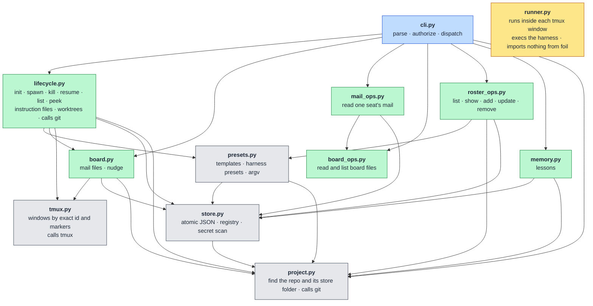
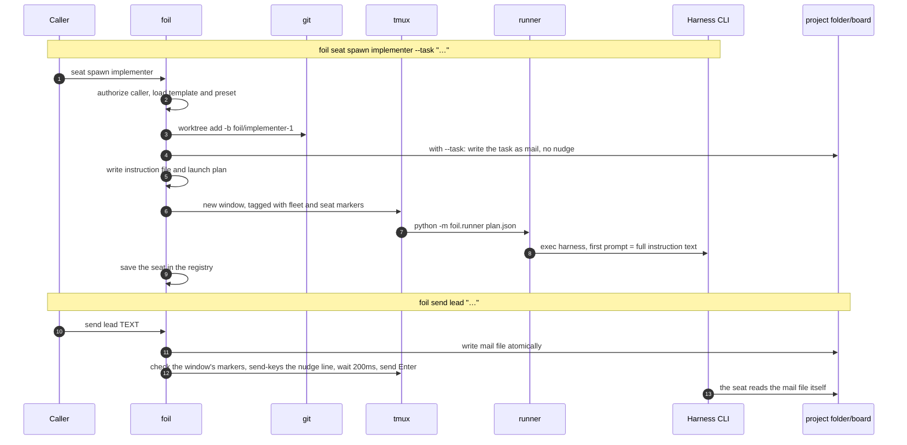

# Architecture

This document describes Foil 0.4.0 as implemented. It does not add requirements. The command list and the data layout are specified in [requirements.md](requirements.md).

## Components

Foil is a Python 3.11+ program with no runtime dependencies. It uses Git, tmux, and the harness CLIs already installed on the machine. Package code lives under `src/foil`.

| Module | Role |
|---|---|
| `src/foil/cli.py` | Parses the command line, decides who the caller is, and dispatches. It does not talk to tmux. |
| `src/foil/project.py` | Finds the Git toplevel and the project folder in the per-user store. |
| `src/foil/store.py` | Writes JSON atomically, loads the registry, and rejects credential-shaped text. |
| `src/foil/presets.py` | Loads harness presets and role templates, scans which eligible presets are installed, and expands launch argv. It does not start a process. |
| `src/foil/roster_ops.py` | Lists, shows, adds, updates, and removes role templates. Writes are atomic and refuse a symlink. |
| `src/foil/lifecycle.py` | Initializes a project and spawns, kills, resumes, lists, and peeks seats. It writes instruction files. |
| `src/foil/tmux.py` | Creates, stops, and reads tmux windows by exact window id. |
| `src/foil/board.py` | Writes mail files, then asks tmux to type the nudge line. |
| `src/foil/mail_ops.py` | Reads one seat's mail. Paths must stay inside the project folder's `board/mail/`. |
| `src/foil/board_ops.py` | Reads and lists board files. Paths must stay inside the project folder's `board/`. |
| `src/foil/memory.py` | Stores project lessons as JSON files. |
| `src/foil/runner.py` | Execs the argv in a launch plan. It does not choose that argv. |
| `src/foil/errors.py` | Carries the one-line errors the CLI prints. |

### Module layers

Each arrow points from a module to one it imports. Every module also raises
the one-line errors in `errors.py`; those arrows are left out.



### Spawn and send

What happens across processes when a seat is spawned with a task, and when
mail is sent later.



Shipped presets are `src/foil/defaults/harnesses`. Shipped personas are `src/foil/defaults/personas`, including the candidate roles. A project file `harnesses/<id>.toml` in the project folder overrides the preset with the same id, so that id is counted once. `init` scans every eligible preset whose own `command[0]` is on `PATH`, skips `fake`, and sorts the ids by Unicode code point with case preserved. That order is a tiebreak, not a ranking. `lead` and `implementer` get the first installed id. `reviewer` gets the second when one exists, and the first otherwise. The report then counts the distinct harness ids stored in those three templates. Two ids can still run the same program or model; set `model` on that entry to choose one. Each default template is one `[[harness]]` entry and omits `model`. Tests put `foil-fake` on `PATH` and point templates at it themselves.

## Where state lives

`foil init` creates the project folder in the per-user store and prints its path. The store root is `$FOIL_HOME` when that is set, otherwise `$XDG_DATA_HOME/foil`, otherwise `~/.local/share/foil`. The folder is `<root>/projects/<key>/`, where `<key>` is a readable slug of the realpath of the Git common dir plus a short hash. It writes nothing into the working tree and no exclude entry. When one stored project has the same origin remote and its recorded path is gone, init adopts that record, renames the folder to the new key, and runs `git worktree repair` on each seat worktree. After adopt or a legacy move, and only after `git worktree repair` succeeds, absolute paths in `run/registry.json`, `run/plans/`, and `run/instructions/` are rewritten to the store paths no matter what the old absolute prefix was, including the old checkout and the old `.foil/` directory. The old `.foil/` prefix is read from a worktree's gitdir text before repair. A stale `FOIL_PROJECT` value in `run/plans/*.json` is rewritten to the current project key, atomically. A failed repair leaves the stored paths unchanged. Running init again finishes that repair and the full rewrite, not only seat worktree paths. The recorded checkout is the one saved before this run writes the current checkout. That path no longer existing, or a seat gitdir that still names a missing path, is the leftover it detects. The old store root or the old `.foil/` is mapped whenever that directory itself no longer exists. When a hand repair has already updated the gitdir, the old store folder is `<projects>/` plus the project key of the checkout recorded before the write. The check that its parent is gone applies only to rewriting the old checkout to the current checkout. A repository with no origin is adopted the same way when exactly one such record stores the same root commit. Several matches adopt none. When no match is possible, init warns, names the orphan's path, and creates a new project folder. Only a record that could be this repository is considered: the same root commit, or no root field and no origin. A record for some other repository is ignored, including when this repository has no commits. The warning does not stop init. An in-repo `.foil/` whose registry still has a seat in a state other than `killed` blocks init, and a stale seat whose tmux window is already gone also counts. That refusal creates nothing in the store. It names each blocking seat and says a stale seat also counts, without claiming that one exists. The order it names is: kill them with the old `foil` (`foil seat kill --all`), then upgrade, then `foil init`. When that old `foil` is no longer on `PATH`, it gives a version-pinned install into a separate tool directory that does not replace the `foil` on `PATH`. It never says to move the directory aside. An in-repo `.foil/` with no such seat is moved into the store when the move is simple. A store that holds only a fresh skeleton is not a collision. A real collision names the stored entry that is already taken. A directory that is not a simple tree says that `board`, `run`, and `templates` must be real directories. Neither message names the kill order, and both leave the old directory in place. The report starts with the version. It then lists every installed eligible harness in id order, the id each default template was given and why, which templates and personas it wrote and which it left alone, `Available personas (use 'foil roster add')` when a persona has no template, `Updated skills: …` or `Skills: current`, a built-in preset overridden by `harnesses/` when one is, a sentence about the permission setting, the project folder path, and the operator pointer line. A re-run prints the report again. It overwrites no template, persona, or preset, and it replaces the operator skill when its bytes differ from this version. It does not write the lead or worker skill, and it does not delete an older copy of either. The directory holds:

- `templates/<role>.toml` — the roster. The file name is the role. `harness` is an ordered list of tables, each with `id` and an optional `model`. The other fields are `persona`, `worktree`, and `permission`. `init` writes one entry and omits `model`. Spawn reads `entries[n % len(entries)]`, where `n` is that role's `harness_cursor` (missing means 0), and saves `n + 1` with the new seat only after the launch succeeds. `foil roster` lists, shows, adds, updates, and removes these files. Add and update write atomically in this directory and refuse a symlink. `roster update` of `harness` or `model` edits a one-entry list and writes `[[harness]]`. A longer list is edited in the file; those two updates are refused and the file is left unchanged. Remove fails while a seat of that role has a stored state other than `killed`. Editing the list while a seat is alive is allowed. That seat keeps the harness and model from its last launch.
- `templates/personas/<role>.md` — every packaged persona, copied once, including candidate roles that have no template yet. A persona adds only specialization the role skill does not already state. A template may instead point `persona` at another Markdown file, which is left untouched, or it may hold inline text.
- `harnesses/` — optional project presets.
- `memory/<id>.json` — lessons. They belong to the project and stay when seats are killed.
- `board/mail/<seat>/` — mail files. Seats read them with `foil mail read` and `foil mail list`, and read notes, tasks, results, and status with `foil board read` and `foil board list`. `mail list` does not follow a symlink at `board/mail`. Foil parses front matter only to print a file and does not act on contract fields.
- `run/registry.json` — fleet id, tmux session name, lead name, `harness_cursor`, and one record per seat: name, template, harness, model, window id, state, worktree, branch, and session id. The seat's `harness` and `model` are the pair from its last launch. Resume keeps them. `harness_cursor` maps a role name to an integer; a missing role means 0, and a registry written without the object loads it as empty. `roster remove` drops that role's key. A seat record from before `model` existed loads that field as empty. The session name is `foil-`, then up to 32 characters of the repository directory name with every non-alphanumeric run turned into a single `-` and the surrounding dashes removed, or `repo` when that leaves nothing, then `-` and the first 8 hex characters of the SHA-256 of the resolved toplevel path. That derivation, the session marker `@foil-fleet-id`, and the window marker `@foil-seat-id` are a cross-version contract. They change only when a release tells you to drain the fleet with the old binary first (`foil seat kill --all`). A mid-goal upgrade works while this contract and the registry schema stay compatible. The recommended path is still between goals: kill the fleet, update, run `foil init`, then spawn the lead.
- `run/instructions/<seat>.md` — generated when that seat is spawned or resumed. It includes the text of that seat's role skill and the Foil version that wrote the file.
- `skills/operator.md` — the operator skill. `init` replaces it when its bytes differ, atomically, and refuses a symlink. The report says `Updated skills: …` or `Skills: current`. The lead and worker skills are read from the package and inlined into the instruction file. An older copy of either in this directory is left unread.
- `run/plans/<seat>.json` — the argv, working directory, and environment for the runner.

A checkout does not contain the project folder. How a seat still finds it is described under "Worktrees, project state, and harness sessions".

## Worktrees, project state, and harness sessions

Seat trees are flat, one level deep, under the project folder in the store. There is no tree for the lead, and one agent's tree is never nested inside another's.

```text
<root>/projects/<key>/             one folder for this Git common dir
  worktrees/
    <label>/                       branch foil/<label>, sibling of every other seat tree
    <label>-2/
```

`<project>` is the Git toplevel where `foil init` ran. It is usually the main checkout. It can itself be a linked worktree, if init ran there. The lead has no tree of its own: `lead.toml` ships with `worktree = false`, so the lead's working directory is `<project>`. Default roles are lead, implementer, and reviewer. By default only the reviewer, besides the lead, has `worktree = false` and shares that same directory.

A template with `worktree = true` gets `<root>/projects/<key>/worktrees/<label>` on a new branch `foil/<label>`. Spawn runs `git worktree add -b` with no start point, so the branch forks from whatever `<project>` has checked out at spawn time, not from `main`. A taken branch or directory uses `foil/<label>-2`, then `-3`, and so on. Spawn never uses `-B`. Every seat tree is a sibling, and all of them register in the same Git common dir. Spawn is lead-or-operator: the CLI allows it for the lead and for the operator outside the fleet. Every command, including `foil mail` and `foil board`, resolves the project the same way. `FOIL_PROJECT`, when it names a store folder that has `project.json`, selects that folder's recorded repository path. Otherwise the command uses the Git toplevel of the working directory. The folder is then `<root>/projects/<key>/` for the realpath of that repository's Git common dir. The main checkout, a linked worktree, and a seat worktree share that common dir, so they share one folder. Spawn refuses a seat worktree path that would land inside the repository, including under a top-level `worktrees/` directory. Killing a seat, or a launch that fails after the worktree exists, does not remove the worktree or the branch. The worktree is outside the repository. Remove one that is clean with `git worktree remove <path>`; a dirty tree needs `--force`, and that discards uncommitted work.

Foil's own state is the project folder: `project.json`, `templates/`, `harnesses/`, `skills/`, `memory/`, `board/` (mail, notes, tasks, results, and status), `run/registry.json`, `run/instructions/`, and `run/plans/`. Nothing Foil owns is written into the working tree, and init writes no exclude entry. An older `/.foil/` line left in `info/exclude` is unused.

| File or directory | Which tree | Tracked? | How a seat reaches it |
| --- | --- | --- | --- |
| Project folder (templates, harnesses, skills, memory, board, run, worktrees) | Store, not a checkout | No (it is outside the repository) | `FOIL_PROJECT`, or the Git common dir |
| `AGENTS.md`, `CLAUDE.md`, `.cursor/rules/`, and similar | Every tree, at that tree's commit | Yes | The seat reads its own checkout; a project-checkout edit arrives only once the seat's branch includes it |
| A gitignored local file (for example a harness settings file) | Project checkout only | No | It does not. `git worktree add` does not copy it, so a worktree seat runs without it while the lead and other non-worktree seats have it |

Foil stores only a session id per seat, in `run/registry.json`. Each harness keeps transcripts and trust under the user's home directory. Foil forwards `HOME`, so every seat writes into the same global store as the human. Those stores are keyed by working directory. Moving or renaming the project changes every key, and a harness that resumes by a directory lookup can then miss the old session. Foil's tmux session name hashes the resolved toplevel path, so a move is a new fleet anyway. `foil init` in the new location adopts the old project folder when one stored record has a recorded path that is gone and matches this repository: the same origin remote, or, when there is no origin, the same root commit. Several matches adopt none. When no match is possible, init warns, names the orphan's path, and creates a new project folder. A record for some other repository is ignored. The warning does not stop init.

| Preset | `session_id` | Resume argv | Scoped by | Verified |
| --- | --- | --- | --- | --- |
| claude | `generated` | `claude --resume {session_id}` | Explicit id | The argv is the preset. Directory-per-cwd storage under `~/.claude/projects/` is observed: names for earlier fleets' seat-worktree paths remain after those seats were killed |
| grok | `generated` | `grok --resume {session_id}` | Explicit id | The argv is the preset. Storage layout unverified |
| fake | `generated` | `foil-fake --session {session_id}` | Explicit id | The argv is the preset |
| codex | `none` | `codex resume --last` | Latest session for this directory | The argv is the preset. Whether "latest" is the exact cwd or the whole repository is unverified |
| opencode | `none` | `opencode . --continue` | Latest session for this directory | The argv is the preset. Whether "latest" is the exact cwd or the whole repository is unverified |
| gemini | `none` | `gemini --resume` | Neither an id nor a directory flag | The argv is the preset. It always starts fresh. The preset marks its flags unverified |

An explicit id stays unambiguous when seats share a working directory. `--continue` and `--last` mean the latest session for this directory, so Foil refuses that native resume for a seat with no worktree and starts it fresh in the project directory. Trust is path-keyed too. A seat worktree lives in the store, outside the repository, so it does not inherit the repository's trust. Each seat label needs folder trust once per harness.

Templates, skills, harnesses, and the board stay per project, inside that project's store folder. There is no user-level layer above the project. The folder is outside the working tree so `git status` stays clean without an exclude entry. The key is the Git common dir, which a linked worktree and a seat worktree already share.

## Authority

The caller is outside the fleet when `FOIL_SEAT_ID` is unset. The lead is the process whose variable is `lead`. Every other value is a worker. The CLI allows or refuses the action before it changes anything. A worker cannot spawn, kill, or resume, and cannot accept or reject a lesson. The lead cannot kill the seat named `lead` and cannot run `foil seat kill --all`. The lead also cannot set a template's `permission`, including `roster add --from` when the file's permission is not `auto`; only a caller outside the fleet can. An omitted permission is `auto`. No flag selects a different identity.

## Spawn

`foil seat spawn TEMPLATE` loads that template and selects `entries[n % len(entries)]`. `n` is `harness_cursor` for the role, and a missing role means 0. A list of one stays on that entry. The same registry save writes the new seat, with that entry's id and model, and stores `n + 1`. A failed launch does not advance the cursor. The lead seat is always named `lead`, and it has to be the first seat. Later seats are named `<template>-1`, `<template>-2`, and so on, unless `--name` is given. A name that is already in the registry is not reused. A generated name that cannot fit the registry's id rule is skipped; if none fit, spawn stops before it creates a worktree or a window.

When the template sets `worktree` true, spawn runs `git worktree add -b` on `foil/<seat>` in the project folder's `worktrees/<label>`. If that branch or its directory is taken, it uses `foil/<seat>-2`, then `foil/<seat>-3`, and so on, and the directory uses the same suffix. The branch is new. Spawn does not use `-B` and does not reset an existing branch. A destination inside the repository, including one under a top-level `worktrees/` directory, is refused. On a later failure it does not remove that worktree or delete the branch. Killing a seat does not either.

Spawn writes the instruction file, then a plan, then a tmux window. The window runs `python -m foil.runner` on the plan. The runner changes to the plan's directory and execs the harness. The plan's own environment sets `FOIL_SEAT_ID` to the seat name and `FOIL_PROJECT` to the project key. It also stores `FOIL_HOME` or `XDG_DATA_HOME` when the spawning process had that variable set, so the seat resolves the same store. Other variables are listed by name in `env_forward` and copied from the window's environment at exec time, so their values are not stored in the plan. `PATH` and `HOME` are always forwarded, and a preset's `env` names any further variables. A variable a preset names takes its value from the tmux server's environment. `PATH` comes from the spawning caller. The first launch prompt is the instruction file's full text. With `--task`, it names that task's mail file and tells the seat to read it first; without `--task`, it tells the seat to run `foil mail list` and read its mail before it acts. Placeholders in the preset are `{model}`, `{prompt}`, and `{session_id}`. A missing value drops that token and a flag that only introduced it. A model that starts with `-` is invalid and is not placed in that argv. Permission extras are inserted for both a fresh start and a resume.

The instruction file includes the persona's text. When the template points at a Markdown file, that file is read and inlined; the file itself is left unchanged.

`--task` is mail written before launch, with no nudge. If launch fails, that file is removed. `foil send` is unchanged: it still writes, then nudges.

## Instruction file

The file is regenerated on spawn and on resume, not when a lesson is accepted later. It names the Foil version that wrote it, the seat, the lead (`lead`), the absolute board path, and the commands that role may run. It includes the role skill's text and the persona's text, not only a path to either, and its last line tells the seat to re-read this file whenever it is woken. It states that mail is a file, that the nudge line is the sender and the mail path, and that notes wake nobody. It names the `status/v1`, `task/v1`, and `result/v1` contracts. It tells a worktree seat to stay in its worktree. Accepted lessons are copied in, or the file says none yet. The lead's file also lists each template's harness entries and whether it asks for a worktree. On a first launch with `--task`, it names that task's mail file, tells the seat to read it first, and says older mail may be from an earlier goal: `foil seat kill` keeps `board/mail/<seat>/`, and the lead's name is always `lead`. Without `--task`, it tells the seat to run `foil mail list` and read its mail before it acts. If this launch is a fresh start after a restart, the file says the seat was restarted and should list its mail with `foil mail list` and read each file with `foil mail read`.

## Mail and nudge

`foil send TO TEXT` checks the recipient against the registry before it writes. An unknown seat prints one stderr line and leaves no file. `TEXT` of `-` reads stdin. The sender is `user` when the caller is outside the fleet, and the seat id when a seat sends. There is no operator mailbox.

The file is Markdown with `contract: mail/v1` and `from`, `to`, and `time`. After the file exists, Foil types one line if the seat's stored window still carries this fleet's and this seat's tmux markers: the sender, a space, and the absolute mail path. The body is not typed. tmux is invoked as `send-keys -l -t @<window id> -- <line>`, and only if that succeeds, Foil waits 200ms, then `send-keys -t @<window id> Enter` once. The wait is what lets a harness submit the line: Codex keeps a fast burst open for 120ms, and Enter inside that burst stays in the input. Foil does not read the pane and does not send Enter again. The window id is the stored id, not a name. tmux reuses window ids after its server restarts, so the marker check keeps a nudge from reaching another seat. If the window is gone or belongs to someone else, the send still succeeds and the file remains. Foil does not read the pane before typing, so the line is typed even when the pane is not at a prompt. A harness that is not reading its input during the wait can still take the line and Enter as one burst.

## Kill, resume, list, and peek

`foil seat kill NAME` stops the stored window id and sets the seat's stored state to `killed`. A window that is already gone is still marked killed. A dead seat whose process has exited can still have its window: remain-on-exit keeps it, and kill removes that leftover window before it marks the seat killed. The name stays reserved. The worktree, branch, and uncommitted files stay.

`foil seat kill --all` does that for every seat. Only a caller outside the fleet can run it.

`foil seat resume NAME` refuses a killed seat. If the named seat's pane process is still running, it prints that the seat is alive and does not launch again. A dead seat can still have a window, because the window stays after the process exits. Resume removes that leftover window before it launches again, so the seat ends with one window. With no name, resume restarts every dead seat and skips killed and alive ones. A seat that cannot be restarted does not stop the others: resume prints `foil: seat '<name>' not resumed: <reason>` on stderr for each one, restarts the rest, and exits 1.

Resume launches with the harness and model stored on the seat. It loads the template for the persona, the permission, and the instruction file, and it does not overwrite the seat's harness or model from that file. The stored harness's preset both decides native resume and builds the argv. The stored session id is kept. A new id is not minted only because the template's first entry differs from the recorded harness. Native resume is used when the preset has a resume argv and a generated session id is present, or when the seat has its own worktree and the argv contains `--continue` or `--last`. A seat with no worktree does not use those directory-scoped flags; it starts fresh in the project directory. Any other seat without a native resume starts fresh. A generated-session preset mints a new id for a fresh start. Permission extras still apply.

Alive, dead, and killed come from the registry and from the tmux window with the stored id. The seat is alive when that window exists, carries this fleet's and this seat's markers, and its pane process is still running. It is dead when the window is gone, when the markers do not match, or when tmux reports `#{pane_dead}` for that window. That flag is a tmux fact about the process, not a reading of the pane. List prints `name`, `template`, `state`, `worktree`, the harness and model recorded at the last launch, and the template's current description, tab-separated, or the same fields as JSON. The description is empty when the template is gone or cannot be read. It does not classify pane text.

`foil seat peek NAME` runs `tmux capture-pane -p -t @<window id> -S -<N>` and writes that stdout unchanged. The default `N` is 40. It does this for an alive seat and for a dead seat whose window still exists and still carries this fleet's and this seat's markers, so a harness that exited at launch leaves an error line that can be read. A killed seat, a dead seat whose window is gone, or a stored id that now names another window is an error. Peek does not interpret the text.

## Memory

`foil memory add` writes a proposed lesson and prints its id. `--replaces` names an existing lesson. `foil memory accept` and `foil memory reject` are limited to the lead and to callers outside the fleet. Accepting a lesson that names a replacement marks the replaced lesson superseded. `foil memory list` prints accepted lessons; `--all` includes proposed, rejected, and superseded. Lessons are included in an instruction file only at the next spawn or resume.

## What Foil does not do

Foil does not parse pane contents or decide that an agent is idle. It parses front matter only to print a file and does not act on contract fields. It does not store harness credentials. It does not delete a worktree or a branch when a seat is killed or when a launch fails after the worktree was created.
