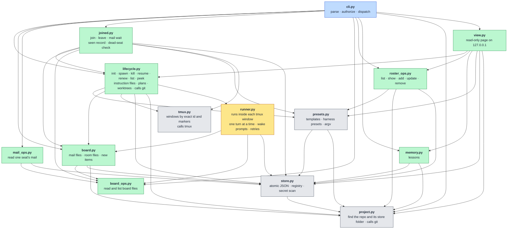

# Architecture

This document describes Foil as implemented. It does not add requirements. The command list and the data layout are specified in [requirements.md](requirements.md).

## Components

Foil is a Python 3.11+ program with no runtime dependencies. It uses Git, tmux, and the harness CLIs already installed on the machine. Package code lives under `src/foil`.

| Module | Role |
|---|---|
| `src/foil/cli.py` | Parses the command line, decides who the caller is, and dispatches. It does not talk to tmux. |
| `src/foil/project.py` | Finds the Git toplevel and the project folder in the per-user store. |
| `src/foil/store.py` | Writes JSON atomically, loads the registry, and rejects credential-shaped text. |
| `src/foil/presets.py` | Loads harness presets and role templates, scans which eligible presets are installed, and expands launch argv. It does not start a process. |
| `src/foil/roster_ops.py` | Lists, shows, adds, updates, and removes role templates. Writes are atomic and refuse a symlink. |
| `src/foil/lifecycle.py` | Initializes a project and spawns, kills, resumes, renews, lists, and peeks seats. It writes instruction files, plans, and each runner's starting record. |
| `src/foil/tmux.py` | Creates, stops, and reads tmux windows by exact window id. It never sends keys. |
| `src/foil/board.py` | Writes mail files and room files, and lists the new items for a mailbox. It does not talk to tmux. |
| `src/foil/mail_ops.py` | Reads one seat's mail. Paths must stay inside the project folder's `board/mail/`. |
| `src/foil/joined.py` | `seat join lead`, `seat leave`, `mail wait`, and the new-items line a joined lead's other commands end with. It keeps the seen record and the dead-seat check. |
| `src/foil/board_ops.py` | Reads and lists board files. Paths must stay inside the project folder's `board/`. |
| `src/foil/memory.py` | Stores project lessons as JSON files. |
| `src/foil/runner.py` | Runs inside each seat's window and runs that seat's turns one at a time from its plan: the first prompt, the wake prompts, retries, pauses, and the runner record. It does not choose the argv. |
| `src/foil/guard.py` | Writes the seat-only `pre-commit` and `pre-push` hooks, and runs their checks for private text and the worktree boundary before the repository's own hook. |
| `src/foil/view.py` | Serves `foil view`, one read-only page on `127.0.0.1` for every project in the store, each under `/projects/<key>/`. It calls the same readers as `seat list`, `seat peek`, `roster list`, and `memory list`, and writes nothing. At start it reads `tailscale status --json` once, so a request that `tailscale serve` forwards from the owner's login can load under the tailnet name. |
| `src/foil/errors.py` | Carries the one-line errors the CLI prints. |

### Module layers

Each arrow points from a module to one it imports. Every module also raises
the one-line errors in `errors.py`; those arrows are left out.



### Spawn and send

What happens across processes when a seat is spawned with a task, and when
mail is sent later.

```mermaid
sequenceDiagram
  autonumber
  participant C as Caller
  participant F as foil
  participant G as git
  participant T as tmux
  participant R as runner
  participant H as Harness CLI
  participant B as project folder/board

  Note over C,H: foil seat spawn implementer --task "…"
  C->>F: seat spawn implementer
  F->>F: authorize caller, load template and preset
  F->>G: worktree add -b foil/implementer-1
  F->>B: with --task: write the task as mail
  F->>F: write instruction file, launch plan, and runner record (task mail in flight)
  F->>T: new window, tagged with fleet and seat markers
  T->>R: python -P -m foil.runner plan.json
  R->>H: first turn: start argv, prompt = instruction text
  H-->>R: the turn exits; the runner records its exit code
  F->>F: save the seat in the registry

  Note over C,B: foil send implementer-1 "…"
  C->>F: send implementer-1 TEXT
  F->>B: write mail file atomically
  R->>B: about once a second: new items for this seat?
  R->>H: next turn: turn argv on the same session, wake prompt lists the new file
  H->>B: the seat reads the file itself
```

Shipped presets are one list, `src/foil/defaults/harnesses.toml`, and each entry names the model ids that harness accepts. `init` does not copy that list. A global `<root>/harnesses.toml` or `<root>/harnesses/<id>.toml` exists only when someone writes a change, and a global preset counts before `init`. Shipped personas are `src/foil/defaults/personas`, including the candidate roles. A project file `harnesses/<id>.toml` is an optional override of the preset with the same id, so that id is counted once. `init` writes no project `roles.toml`, `mapping.toml`, or `harnesses.toml`, and it deletes those paths. `roles.toml` is the profile list (role and description). `mapping.toml` is the default harness and model. `fleets/<id>/overrides.toml` holds that fleet's harness and model overrides, and that fleet's `board/room/` holds posts. `FOIL_FLEET` selects the fleet and defaults to `main`. `init` scans every eligible preset whose own `start[0]` is on `PATH`, skips `fake`, and sorts the ids by Unicode code point with case preserved. That order is a tiebreak, not a ranking. `lead` and `implementer` get the first installed id. `reviewer` gets the second when one exists, and the first otherwise. The report then counts the distinct harness ids stored in those three templates. Two ids can still run the same program or model; set `model` on that entry to choose one. Each default role is one `[[map]]` row and omits `model`. Tests put `foil-fake` on `PATH` and point the mapping at it themselves.

## Where state lives

`foil init` creates the project folder in the per-user store and prints its path. The store root is `$FOIL_HOME` when that is set, otherwise `$XDG_DATA_HOME/foil`, otherwise `~/.local/share/foil`. The folder is `<root>/projects/<key>/`, where `<key>` is a readable slug of the realpath of the Git common dir plus a short hash. It writes nothing into the working tree and no exclude entry. When one stored project has the same origin remote, compared without HTTP userinfo, and its recorded path is gone, init adopts that record, renames the folder to the new key, and runs `git worktree repair` on each seat worktree. After adopt or a legacy move, and only after `git worktree repair` succeeds, absolute paths in `run/registry.json`, `run/plans/`, `run/instructions/`, and `run/archive/` are rewritten to the store paths no matter what the old absolute prefix was, including the old checkout and the old `.foil/` directory. The old `.foil/` prefix is read from a worktree's gitdir text before repair. A stale `FOIL_PROJECT` value in `run/plans/*.json` is rewritten to the current project key, atomically. A failed repair leaves the stored paths unchanged. Running init again finishes that repair and the full rewrite, not only seat worktree paths. The recorded checkout is the one saved before this run writes the current checkout. That path no longer existing, or a seat gitdir that still names a missing path, is the leftover it detects. The old store root or the old `.foil/` is mapped whenever that directory itself no longer exists. When a hand repair has already updated the gitdir, the old store folder is `<projects>/` plus the project key of the checkout recorded before the write. The check that its parent is gone applies only to rewriting the old checkout to the current checkout. A repository with no origin is adopted the same way when exactly one such record stores the same root commit. Several matches adopt none. When no match is possible, init warns, names the orphan's path, and creates a new project folder. Only a record that could be this repository is considered: the same root commit, or no root field and no origin. A record for some other repository is ignored, including when this repository has no commits. The warning does not stop init. An in-repo `.foil/` whose registry still has a seat in a state other than `killed` blocks init, and a stale seat whose tmux window is already gone also counts. That refusal creates nothing in the store. It names each blocking seat and says a stale seat also counts, without claiming that one exists. The order it names is: kill them with the old `foil` (`foil seat kill --all`), then upgrade, then `foil init`. When that old `foil` is no longer on `PATH`, it gives a version-pinned install into a separate tool directory that does not replace the `foil` on `PATH`. It never says to move the directory aside. An in-repo `.foil/` with no such seat is moved into the store when the move is simple. A store that holds only a fresh skeleton is not a collision. A real collision names the stored entry that is already taken. A directory that is not a simple tree says that `board`, `run`, and `templates` must be real directories. Neither message names the kill order, and both leave the old directory in place. The report starts with the version. It then lists every installed eligible harness in id order, the id each default template was given and why, which templates it wrote and which it left alone, `Wrote personas: none`, `Left personas:`, `Available personas (use 'foil roster add')` when a persona has no template, `Removed:` for each project path it deletes, a built-in preset overridden by `harnesses/` when one is, a sentence about the permission setting, the project folder path, the star line when one is due, and the pointer line. The star line shows on the first `init` in a store, then after at least 3 and 14 more days, then once per newer minor version at least 30 days after the last one, unless `stop` is true in `<root>/star.json`. That record is written after the rest of the report has been flushed, just before the line, and the line prints only when the write succeeded. A failed write is ignored. The write is atomic and does not change the store root's mode. A re-run prints the report again. It overwrites no template, persona, or preset, and it writes no skill. `init` deletes `<project>/skills/operator.md`, `<project>/skills/lead.md`, and `<project>/skills/worker.md`. Global settings live at `<root>/`:

- `<root>/roles.toml` and `<root>/mapping.toml` — the shared lists. Every fleet uses them. `init` writes each missing default role and one mapping row per missing role, and omits `model`. Permission defaults to `auto`. `<root>/harnesses.toml` exists only when someone writes a change. A global preset counts before `init`. `init` writes no project `roles.toml`, `mapping.toml`, or `harnesses.toml`, and it deletes those paths.
- `<root>/personas/<role>.md` — a persona someone changed. Packaged personas are read from the package and are not copied. A project `personas/<role>.md` is an optional override. `init` deletes a project `templates/` directory. A persona adds only specialization the role skill does not already state. A template may instead point `persona` at another Markdown file, which is left untouched, or it may hold inline text.
- `<root>/harnesses/<id>.toml` — one harness someone changed. It counts before `init`. A project `harnesses/<id>.toml` is an optional override of that id. `init` deletes a project `harnesses/` and does not create one.
- No skill. `init` writes no skill into the store or the project, and it deletes `<project>/skills/operator.md`, `<project>/skills/lead.md`, and `<project>/skills/worker.md`. The pointer line is `Run foil seat join lead, then read the file it names. My goal: <goal>.` The joined lead's skill arrives in the instruction file the join writes.

The project folder holds:

- `fleets/<id>/` — one fleet. `overrides.toml` is the harness and model memory: a role's rows replace its mapping rows in that fleet. The lead instruction names that file and says to re-read it before spawn. `board/` holds mail, notes, tasks, results, status, and `room/` posts. `mail list` does not follow a symlink at `board/mail`. `run/` holds the registry and generated files. `FOIL_FLEET` selects the directory and defaults to `main`. Spawn reads the shared mapping, then applies that fleet's override as the harness model flag. Resume keeps the recorded pair. `foil init` moves a 0.4 project-root `board/` and `run/` under `fleets/main/` when those fleet copies are absent or empty, and rewrites those absolute prefixes inside that fleet's `run/`. It does not import `templates/<role>.toml`.
- `memory/<id>.json` — lessons. They belong to the project and stay when seats are killed.
- `fleets/<id>/board/room/<thread>/` — one thread. `foil post` writes `room/v2` files here. The root file is `<thread>/<thread>.md`. A reply is a child in that directory. `wakes` lists the seats the post wakes. A decline's `wakes` is empty. Seats read mail, notes, tasks, results, status, and room files with `foil board read` and `foil board list`. Apart from `contract`, `wakes`, and `from`, which decide what wakes a seat, and the `questions` and `decisions` that `foil view` shows, Foil parses front matter only to print a file.
- `fleets/<id>/run/registry.json` — fleet id, tmux session name, lead name, and one record per seat: name, template, harness, model, window id, state, worktree, branch, and session id. The seat's `harness` and `model` are the pair from its last launch. Resume keeps them. A seat record from before `model` existed loads that field as empty. The session name is `foil-`, then up to 32 characters of the repository directory name with every non-alphanumeric run turned into a single `-` and the surrounding dashes removed, or `repo` when that leaves nothing, then `-` and the first 8 hex characters of the SHA-256 of the resolved toplevel path. The `main` fleet uses that name. Another fleet appends `-{id}` so the sessions stay separate. That derivation, the session marker `@foil-fleet-id`, and the window marker `@foil-seat-id` are a cross-version contract. They change only when a release tells you to drain the fleet with the old binary first (`foil seat kill --all`). A mid-goal upgrade works while this contract and the registry schema stay compatible. The recommended path is still between goals: kill the fleet, update, run `foil init`, then spawn the lead. Archive files are not keys in this file. The schema stays 1.
- `fleets/<id>/run/archive/<time>-<name>.txt` — one prose record of an archived seat, written by `foil seat archive`. The fields are the nine seat fields, one per line, with the worktree path after a space. Init's path rewrite covers this directory. An old binary never reads these files and never deletes them.
- `fleets/<id>/run/instructions/<seat>.md` — generated when that seat is spawned or resumed. It includes the text of that seat's role skill and the Foil version that wrote the file.
- `fleets/<id>/run/plans/<seat>.json` — the `start` and `turn` argv, which turn runs first, the working directory, the environment, the instruction path, the reader of the runner's notices, `turn_timeout`, and the retry waits. The plan sets `FOIL_FLEET`.
- `fleets/<id>/run/turns/<seat>.json` — the runner record: the session id the next turn uses, the delivered and in-flight board paths (absent delivered paths dropped on save, and the oldest dropped if the record would exceed its size limit), when the running turn started, the last exit code, the failures in a row, whether the session has been started, whether the seat is paused, and the running turn's process group. Spawn, resume, and renew write it before the runner starts; after that only the runner writes it. `<seat>.resume` beside it retries a paused seat, and `<seat>.renew` asks a running seat's runner to start the new session after its current turn.
- `fleets/<id>/run/foil/<mailbox>/<file>` — the byte length and SHA-256 digest of each mail Foil itself wrote from `foil`. Mail named as from `foil` without a matching size and digest is skipped (size first), so a file written or replaced on the board cannot speak for Foil.
- `fleets/<id>/run/seats/<name>.json` — the seen record for a mailbox a caller outside the fleet reads, `lead` or `user`: the board paths marked seen (by the join brief and `mail wait --timeout 0`; a blocking wait leaves them new), the quiet waits in a row, the seats reported dead and not seen alive since, the time of the last dead-seat check, and the join time. It is written under `run/seats/<name>.lock`.

A checkout does not contain the project folder. How a seat still finds it is described under "Worktrees, project state, and harness sessions".

## Worktrees, project state, and harness sessions

Seat trees are flat, one level deep, under the project folder in the store. One agent's tree is never nested inside another's.

```text
<root>/projects/<key>/             one folder for this Git common dir
  worktrees/
    goal-<fleet>/                  a launched lead's tree, branch foil/goal-<fleet>
    <label>/                       branch foil/<label>, sibling of every other seat tree
    <label>-2/
```

`<project>` is the Git toplevel where `foil init` ran. It is usually the main checkout. It can itself be a linked worktree, if init ran there. A launched lead gets `worktrees/goal-<fleet>` on a new branch `foil/goal-<fleet>` from `<project>`'s `HEAD`, whatever its template says, and integrates there, so several fleets can each work on a goal at once. In that fleet a worker's branch forks from the lead's branch, and a seat whose role has `worktree = false`, the reviewer by default, runs in the lead's tree. A joined lead has no tree: it works in your checkout, workers fork from `<project>`'s `HEAD`, and a seat without a worktree runs in `<project>`.

A template with `worktree = true` gets `<root>/projects/<key>/worktrees/<label>` on a new branch `foil/<label>`. Spawn runs `git worktree add -b` from the lead's goal branch when the fleet has one, and otherwise with no start point, so the branch forks from whatever `<project>` has checked out at spawn time, not from `main`. A taken branch or directory uses `foil/<label>-2`, then `-3`, and so on. Spawn never uses `-B`. Every seat tree is a sibling, and all of them register in the same Git common dir. Spawn is lead-or-outside: the CLI allows it for the lead and for a caller outside the fleet, which is the joined lead while one is joined. Every command, including `foil mail` and `foil board`, resolves the project the same way. `FOIL_PROJECT`, when it names a store folder that has `project.json`, selects that folder's recorded repository path. Otherwise the command uses the Git toplevel of the working directory. The folder is then `<root>/projects/<key>/` for the realpath of that repository's Git common dir. The main checkout, a linked worktree, and a seat worktree share that common dir, so they share one folder. Spawn refuses a seat worktree path that would land inside the repository, including under a top-level `worktrees/` directory. Killing a seat, archiving a seat, or a launch that fails after the worktree exists, does not remove the worktree or the branch. The worktree is outside the repository. Remove one that is clean with `git worktree remove <path>`; a dirty tree needs `--force`, and that discards uncommitted work.

Foil's own state is the store: `<root>/roles.toml`, `<root>/mapping.toml`, and, when someone wrote them, `<root>/harnesses.toml`, `<root>/harnesses/`, and `<root>/personas/`, plus the project folder's `project.json`, `memory/`, `worktrees/`, and `fleets/<id>/` (`overrides.toml`, `board/` including room threads, and `run/` including `archive/`). `init` writes no project `roles.toml`, `mapping.toml`, or `harnesses.toml`, and it deletes those paths along with a project `harnesses/`, `templates/`, and the three project skill files. Nothing Foil owns is written into the working tree, and init writes no exclude entry. An older `/.foil/` line left in `info/exclude` is unused.

| File or directory | Which tree | Tracked? | How a seat reaches it |
| --- | --- | --- | --- |
| Store (global lists, project folder, memory, fleets, worktrees) | Store, not a checkout | No (it is outside the repository) | `FOIL_PROJECT`, or the Git common dir |
| `AGENTS.md`, `CLAUDE.md`, `.cursor/rules/`, and similar | Every tree, at that tree's commit | Yes | The seat reads its own checkout; a project-checkout edit arrives only once the seat's branch includes it |
| A gitignored local file (for example a harness settings file) | Project checkout only | No | It does not. `git worktree add` does not copy it, so a worktree seat runs without it while the lead and other non-worktree seats have it |

Foil stores only a session id per seat, in `fleets/<id>/run/registry.json`. Each harness keeps transcripts and trust under the user's home directory. Foil forwards `HOME`, so every seat writes into the same global store as the human. Those stores are keyed by working directory. Moving or renaming the project changes every key, and a harness that resumes by a directory lookup can then miss the old session. Foil's tmux session name hashes the resolved toplevel path, so a move is a new fleet anyway. `foil init` in the new location adopts the old project folder when one stored record has a recorded path that is gone and matches this repository: the same origin remote, compared without HTTP userinfo, or, when there is no origin, the same root commit. Several matches adopt none. When no match is possible, init warns, names the orphan's path, and creates a new project folder. A record for some other repository is ignored. The warning does not stop init.

Every built-in preset runs its CLI headless, one process per turn, and continues one session by an explicit id. None has been run live against its CLI, so each marks `start` and `turn` unverified.

| Preset | `session_id` | Turn argv | Verified |
| --- | --- | --- | --- |
| claude | `generated` | `claude -p {prompt} --disallowedTools AskUserQuestion --resume {session_id} --model {model}` | Unverified |
| gemini | `generated` | `gemini -p {prompt} --resume {session_id} --skip-trust --model {model}` | Unverified |
| grok | `generated` | `grok -p {prompt} --resume {session_id} --model {model}` | Unverified |
| codex | `output`, key `thread_id` | `codex exec {permission} --json --model {model} resume {session_id} {prompt}` | Unverified |
| opencode | `output`, key `sessionID` | `opencode run {permission} --format json --session {session_id} --model {model} {prompt}` | Unverified |
| fake | `generated` | `foil-fake --resume {session_id} {prompt}` | Test harness |

With `generated`, Foil makes a UUID at spawn and the first turn's `start` argv creates the session under it. With `output`, the CLI makes the id: the runner reads it from the first line of the first turn's stdout that is a JSON object holding the preset's key, stores it in the runner record, and puts it in every later turn. That one value is all the runner reads from a turn's output.

A preset's optional `wake` argv is how `foil mail wait --wake` reaches a joined lead's session from outside it. Only `codex` has one: `codex queue --thread {session_id} --message {text} --resume`, unverified. `joined.py` reads it with `load_preset(..., global_only=True)`, so a project harness file cannot change what runs, even where a joined lead's file tools could write it, and it runs the argv without a shell.

An explicit id stays unambiguous when seats share a working directory, so no preset resumes the latest session for a directory. A headless turn has no folder-trust prompt to answer; the `gemini` preset passes `--skip-trust`.

Global roles, the default mapping, harness files someone wrote, and changed personas live at `<root>/`, shared by every project. Each fleet has its own board, room, and registry in that project's folder. `<root>/star.json` records when `init` last printed the star line, so the line is counted per store and not per project. The folder is outside the working tree so `git status` stays clean without an exclude entry. The key is the Git common dir, which a linked worktree and a seat worktree already share.

## Authority

The caller is outside the fleet when `FOIL_SEAT_ID` is unset. Outside the fleet, a command acts as `lead` while the registry stores the lead seat as `joined`, and as `user` otherwise; a joined lead keeps every right of a caller outside the fleet. The lead is the process whose variable is `lead`. Every other value is a worker. The CLI allows or refuses the action before it changes anything. A worker cannot spawn, kill, archive, resume, or renew, and cannot accept or reject a lesson. The lead cannot kill or archive the seat named `lead` and cannot run `foil seat kill --all`. The lead also cannot set a template's `permission`, including `roster add --from` when the file's permission is not `auto`; only a caller outside the fleet can. An omitted permission is `auto`. No flag selects a different identity.

## Spawn

`foil seat spawn TEMPLATE` loads that template and selects `entries[n % len(entries)]`. `n` is the registry's `rotation` count for that role when its stored `list` matches the role's mapping rows and that fleet's override rows, written as `roster list` prints them, and 0 when it does not, so an edited list starts at its first entry. A list of one stays on that entry. The registry save writes the new seat with that entry's id and model, and stores the list with `n + 1`. A killed or archived seat was a spawn, so it counts, and every spawn of the lead advances the count. A failed launch stores nothing, so a retry selects the same entry. Resume does not change the count. When the chosen model is not in that harness's non-empty `models`, spawn prints one warning line on stderr and launches anyway; `roster add` and `roster update` warn the same way. The lead seat is always named `lead`, and it has to be the first seat. Later seats are named `<template>-1`, `<template>-2`, and so on, unless `--name` is given. A name that is already in the registry is not reused. `foil seat archive` removes a killed worker's record, and that name can be spawned again. Auto-numbering may reclaim it. The lead's record is still overwritten on the next spawn of `lead`, and `archive` refuses `lead`. A generated name that cannot fit the registry's id rule is skipped; if none fit, spawn stops before it creates a worktree or a window.

When the template sets `worktree` true, spawn runs `git worktree add -b` on `foil/<seat>` in the project folder's `worktrees/<label>`. If that branch or its directory is taken, it uses `foil/<seat>-2`, then `foil/<seat>-3`, and so on, and the directory uses the same suffix. The branch is new. Spawn does not use `-B` and does not reset an existing branch. A destination inside the repository, including one under a top-level `worktrees/` directory, is refused. On a later failure it does not remove that worktree or delete the branch. Killing a seat does not either.

Spawn writes the instruction file, then a plan, then a tmux window. The window runs `python -P -m foil.runner` on the plan. The runner changes to the plan's directory and runs one turn at a time, each in its own process group with stdin from `/dev/null`, as the next section describes. The plan's own environment sets `FOIL_SEAT_ID` to the seat name, `FOIL_PROJECT` to the project key, and `FOIL_FLEET` to the fleet id. It also stores `FOIL_HOME` or `XDG_DATA_HOME` when the spawning process had that variable set, so the seat resolves the same store. `GIT_CONFIG_COUNT`, `GIT_CONFIG_KEY_0`, and `GIT_CONFIG_VALUE_0` set `core.hooksPath` to the project folder's `hooks/` for that seat's git only, `FOIL_GIT_COMMON` is the project's Git common dir, and `FOIL_WORKTREE` is the seat's worktree when it has one. Spawn and resume write one hook per client hook name, except `reference-transaction` and `fsmonitor-watchman`, and replace a file only when its text changed. Each runs `python -P -m foil.guard` with the interpreter that runs Foil. The checks run only in a repository whose common dir is `FOIL_GIT_COMMON`; elsewhere the hooks only pass through. `pre-commit` refuses a commit outside the seat's worktree and staged lines with private text. `pre-push` scans the message and added lines of each pushed commit that is on no remote. When they pass, the repository's own hook of the same name runs with the same arguments and input, found with `git rev-parse --git-path hooks` without the `GIT_CONFIG_*` variables. Other variables are listed by name in `env_forward` and copied from the window's environment at exec time, so their values are not stored in the plan. `PATH` and `HOME` are always forwarded, and a preset's `env` names any further variables. A variable a preset names takes its value from the tmux server's environment. `PATH` comes from the spawning caller. A preset's `set_env` rows are fixed values written into the plan's own environment, under Foil's variables, which win; the built-in `opencode` preset uses one to deny its `question` tool. The first prompt is the instruction file's full text when the file is under 64 KiB, and otherwise one line naming it. With `--task`, the file names that task's mail file and tells the seat to read it first; without `--task`, it tells the seat to run `foil mail list` and read its mail before it acts. Placeholders in the preset are `{model}`, `{prompt}`, `{session_id}`, and `{permission}`. Spawn fills `{model}` and `{permission}`; the plan keeps `{prompt}` and `{session_id}`, which the runner fills for each turn from its record, or from the plan's generated id. A missing model drops that token and a flag that only introduced it. A model that starts with `-` is invalid and is not placed in that argv. Permission extras go at `{permission}`, or at the end, for both `start` and `turn`.

The instruction file includes the persona's text. When the template points at a Markdown file, that file is read and inlined; the file itself is left unchanged. A launch whose prompt is that file tells the seat to list `board/room` and read the open rooms this seat is a member of or that name it as @name, where it has not answered. That sentence is the late-joiner offer. There is no lead-written ledger.

`--task` is mail written before launch. The runner record puts it in flight for the first turn, and every other item already on the board in delivered, so a runner that stops in its first turn gives the task again and mail from an earlier goal is not new. If launch fails, that file is removed.

## Instruction file

The file is regenerated on spawn and on resume, not when a lesson is accepted later. It names the Foil version that wrote it, the seat, the lead (`lead`), the absolute board path, and the commands that role may run. It includes the role skill's text and the persona's text, not only a path to either, and its last line tells the seat to re-read this file whenever it is woken. It states that mail is a file, that a room file is `foil post`, that a wake prompt lists each new file as its time, sender, and absolute path, that a path under `board/mail/` is `foil mail read` and a path under `board/room/` is `foil board read`, and that notes wake nobody. It says send is one seat, post is a room's members, the task and result files are the durable record, and a note wakes nobody. It tells the seat to list `board/room` and read the open rooms this seat is a member of or that name it as @name, where it has not answered. It names the `status/v1`, `task/v1`, `result/v1`, and `room/v2` contracts. It tells a worktree seat to stay in its worktree. Accepted lessons are copied in, or the file says none yet. The lead's file also lists each template's harness entries and whether it asks for a worktree. It names that fleet's `overrides.toml`, says to re-read it before spawn, and says spawn applies the model as the harness model flag. The lead does not pass a model flag. On a first launch with `--task`, it names that task's mail file and tells the seat to read it first. Without `--task`, it tells the seat to run `foil mail list` and read its mail before it acts. A first launch also says older mail may be from an earlier goal when the seat is the lead, or when that fleet's `run/archive/` has a file for that name. That is one sentence. `foil seat kill` and `foil seat archive` both keep `board/mail/<seat>/`. If this launch is a `start` after a restart, the file says the seat was restarted and should list its mail with `foil mail list` and read each file with `foil mail read`.

The packaged lead skill marks some paragraphs `<!-- launched -->` or `<!-- joined -->`, each closed by `<!-- end -->`. `_for_lead` keeps one kind and drops the marks, so neither lead reads a line meant for the other. `seat join lead` writes the joined form, then the joined skill without Setup, Roster, The viewer, and Teardown and upgrading, and a last line that says to re-read the file after the harness compacts the conversation, or when unsure.

## Turns

The runner prints `foil: turn started (start)` or `(turn)` before each turn and `foil: turn ended (exit <code>)` after it, and passes everything else the CLI writes to the pane untouched. Between turns it checks about once a second for new items, by the same rules `foil mail wait` uses: mail in the seat's mailbox and `room/v2` files whose `wakes` names it, minus the delivered set. After the first one it waits a second more, marks them in flight, and starts a turn on the `turn` argv with a wake prompt: `New for <seat> (N):`, one `time from path` line per item up to 50 and a count of the rest, the body of each listed mail of 600 bytes or less while the bodies stay within 16 KiB (front matter from the first 8 KiB, body read at most 601 bytes), and the line to re-read the instruction file. After a restart the prompt starts with the restart line. A turn that exits 0 moves its items to delivered. A turn whose program cannot be run ends with exit 127. One that exits non-zero runs again after 30 seconds, 2 minutes, and 8 minutes, as a `turn` once the session was started and otherwise as a `start` on a fresh generated id, with any newer items; then the seat is paused, and the runner mails the reader (`lead`, or `user` for the lead) from `foil` and waits for `<seat>.resume`. A turn past `turn_timeout` is ended with its process group; when the session is started its items are delivered and it is not retried, and otherwise the items stay in flight and `start` runs again on a fresh generated id. A worker turn that exits 0 having written no mail, room file, or result gets a mail to the lead. After every turn the runner ends what is left in the turn's process group. A signal ends a turn with exit 128 plus its number.

## Mail

`foil send TO TEXT` checks the recipient against the registry before it writes. An unknown seat prints one stderr line and leaves no file. `TEXT` of `-` reads stdin. The sender is the seat id when a seat sends. Outside the fleet it is `lead` while a lead is joined, and `user` otherwise. `TO` of `user` is the human's mailbox, `board/mail/user/`. Only a launched lead writes it. A joined lead asks in its own chat. Outside the fleet, `foil mail list` lists the joined lead's mailbox, or the human's. A joined lead reads new items with `foil mail wait`, which also prints room files whose `wakes` names it.

The file is Markdown with `contract: mail/v1` and `from`, `to`, and `time`. Writing it is all `send` does: the recipient's runner picks it up between turns. Mail from `foil` is written with a digest record under `run/foil/` first, and only counts while that digest still matches the file.

## Room

`foil post TEXT` opens a room: it writes `board/room/<id>/<id>.md` with contract `room/v2` (`from`, `time`, `members`, `wakes`). Only the lead and an outside caller open a room. The members are the caller plus `--members NAMES`, or the caller plus every other seat that is not killed. Opening a room wakes its other members that are seats and every other seat named in the text as `@id`, and `wakes` lists them. `TEXT` of `-` reads stdin. `--re PATH` writes a child in that room, sets `re` to the parent path, and wakes every other member whose last file there is not a decline, and each other seat named in the text as `@id`, except killed seats. A member that is not a seat, such as `user`, is not woken. The room's state comes from its files in `time` and then name order (a child's name carries a microsecond stamp): the newest `members` list wins, and `closed: true` closes it. `--members NAMES` on a reply, from the lead or an outside caller, sets the members and wakes only those it adds. `--close` stores `closed: true` and wakes only the `@id` seats, and a closed room refuses every later post and decline. `--re` must be absolute, contain no `..`, and name an existing regular file under `board/room/<id>/` that is not a symlink. `--decline` writes a child whose body is the line `decline` and whose `wakes` is empty. A waking file starts with a short preamble that names this file and tells the seat how to reply or decline. A dead or paused seat is still listed in `wakes`, so it gets the post when it is resumed. `post` creates `board/room` when an older project lacks it. A hand-written `room/v2` file whose `wakes` names a seat is delivered to it like any other: rooms are cooperative (F5).

## Kill, resume, list, and peek

`foil seat kill NAME` stops the stored window id and sets the seat's stored state to `killed`. A window that is already gone is still marked killed. A dead seat whose process has exited can still have its window: remain-on-exit keeps it, and kill removes that leftover window before it marks the seat killed. The name stays reserved until `foil seat archive`. The worktree, branch, and uncommitted files stay.

`foil seat archive NAME` frees a killed worker's name. A live or dead seat is refused, so a crashed seat is resumed or killed first. The command holds `run/registry.lock` while it probes the stored window, writes `run/archive/<time>-<name>.txt`, and removes the registry key. A second archive waits on that lock. Spawn, kill, and resume re-read the registry under the same lock before they write, so they do not put an archived seat back. The only probe result that proceeds is `DEAD` with `identity_matches` false, which is also what an empty window id, a non-`@` id, a failed `display-message`, and an empty tmux line return. Any other result, including `TmuxError`, writes nothing. The prose file is written first and is kept if the registry replace does not finish. It is not JSON, so the path rewrite can see the worktree path and an old binary cannot drop it by loading the registry. Stdout names the seat and, when there was a worktree, the branch. It does not print a path. `foil seat list` omits the seat. `foil seat list --archived` prints the stored path and does not probe tmux. Nothing on disk is deleted. A dirty worktree is left in place on purpose. The next spawn of that name is an ordinary spawn. The old branch and directory stay, so the new worktree takes the next suffix.

`foil seat kill --all` stops every seat and marks each one `killed`. It does not archive them, and it does not free their names. Only a caller outside the fleet can run it.

`foil seat resume NAME` refuses a killed seat. A paused seat gets `run/turns/<seat>.resume`, and its runner retries at once. If the named seat's runner is still running otherwise, it prints the seat's state and does not launch again. A dead seat can still have a window, because the window stays after the process exits. Resume removes that leftover window before it launches again, so the seat ends with one window. With no name, resume restarts every dead seat, retries every paused one, and skips the rest. A seat that cannot be restarted does not stop the others: resume prints `foil: seat '<name>' not resumed: <reason>` on stderr for each one, restarts the rest, and exits 1.

Resume launches with the harness and model stored on the seat. It loads the template for the persona, the permission, and the instruction file, and it does not overwrite the seat's harness or model from that file. The session id is the runner record's, or the registry's. When the record says the session was started, the new runner's first turn is a `turn` on that session with the restart line; otherwise it is a `start`, on a fresh generated id when the preset makes its own. Permission extras still apply.

`foil seat renew NAME` needs `board/handoffs/<name>.md`. Under the registry lock it refuses a seat that is now killed, joined, or whose window or session id changed, takes the role's next harness entry, and stores the new harness, model, and session id. Then it writes the instruction and plan. A dead seat is launched at once; a running seat gets `run/turns/<seat>.renew`, and its runner starts that session after the current turn, in the same window. The first prompt names the handoff, and everything already on the board counts as delivered.

Dead and killed come from the registry and from the tmux window with the stored id. The seat is alive when that window exists, carries this fleet's and this seat's markers, and its pane process is still running; an alive seat is `working` while its runner record has a turn started, `paused` when the record says so, and `idle` otherwise. It is dead when the window is gone, when the markers do not match, or when tmux reports `#{pane_dead}` for that window. That flag is a tmux fact about the process, not a reading of the pane. List prints `name`, `template`, `state`, `worktree`, the harness and model recorded at the last launch, the session id or `-`, and the template's current description, tab-separated, or the same fields as JSON with the runner's `turn_started` and `last_exit`. `--all-fleets` leads each line with the fleet id. The description is empty when the template is gone or cannot be read. It does not classify pane text.

`foil seat peek NAME` runs `tmux capture-pane -p -t @<window id> -S -<N>` and writes that stdout unchanged. The default `N` is 40. It does this for an alive seat and for a dead seat whose window still exists and still carries this fleet's and this seat's markers, so a runner that died leaves its last output readable. A killed seat, a dead seat whose window is gone, or a stored id that now names another window is an error. Peek does not interpret the text.

## Memory

`foil memory add` writes a proposed lesson and prints its id. `--replaces` names an existing lesson. `foil memory accept` and `foil memory reject` are limited to the lead and to callers outside the fleet. Accepting a lesson that names a replacement marks the replaced lesson superseded. `foil memory list` prints accepted lessons; `--all` includes proposed, rejected, and superseded. Lessons are included in an instruction file only at the next spawn or resume.

## What Foil does not do

Foil does not parse pane contents or a turn's output, except an `output` preset's session id, and it types nothing into a pane. Apart from the fields that decide a wake and the ones `foil view` shows, it parses front matter only to print a file. It does not store harness credentials. It does not delete a worktree or a branch when a seat is killed, when a seat is archived, or when a launch fails after the worktree was created.
